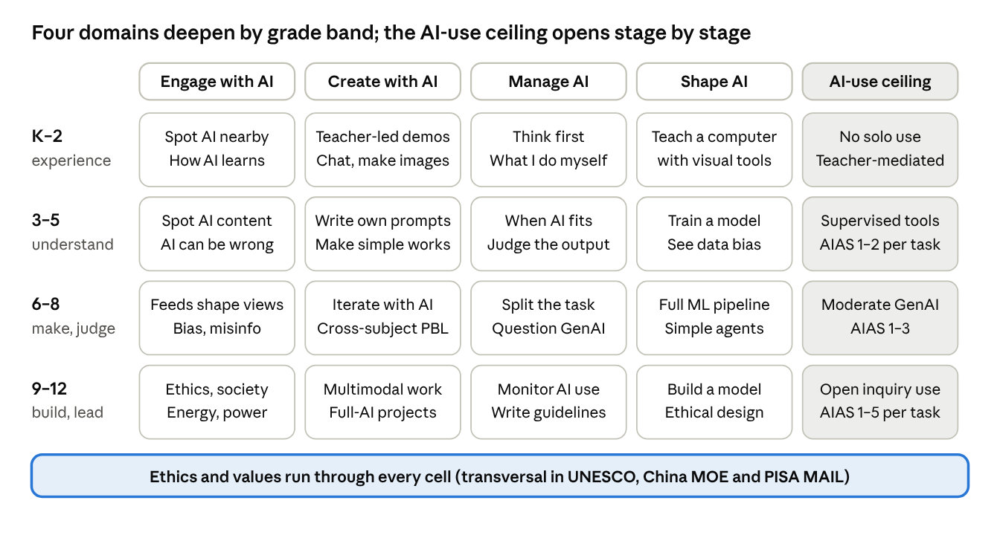

# K-12 AI Literacy Frameworks: A Literature Review

Oct 25, 2026 · @Mike MA

## One-page summary

There is no single "best" K-12 AI literacy framework, but there is a set of tools that combine directly: use UNESCO (2024) or the OECD/EC AILit Framework (2026) to define *what* to learn, use AI4K12 and the Hong Kong/Hangzhou year-by-year examples to define *when*, and use the AI Assessment Scale to define *how much AI* each assignment allows.

**Five angles to think from** (also the structure of this review):

1. Dimensions (what to learn): engage with and critique AI, create with AI, manage the division of work with AI, understand and shape AI; ethics and values run through all four.
2. Grade bands (when): K-2 perceive and experience; 3-5 understand, start using and train simple models; 6-8 run the full machine-learning cycle and use generative AI critically; 9-12 build systems and handle complex ethics.
3. Levels of use (how much): policy sets a ceiling per grade band; each assignment is labelled on the five-level AI Assessment Scale.
4. School posture (how to organise): AI as curriculum content, AI as a subject tool, AI as the teaching engine, students creating with AI. "AI-native schools" are the third posture and are a different thing from AI literacy education.
5. Teachers and assessment (what makes it real): teacher frameworks come first; measure with performance tasks.

**The most current documents (2025–2026):** the final OECD/EC AILit Framework (June 2026; 4 domains, 19 competences × 3 levels); the first draft of the PISA 2029 Media and AI Literacy assessment framework (2026; the first international test of 15-year-olds' AI literacy); the ETS K-12 progression and task-design principles (November 2025); China's two Ministry of Education guidelines (May 2025) and Hong Kong's learning framework (June 2026, with year-by-year examples for Primary 2–6); and Yang et al. (2026), the first systematic review that maps competencies by grade band.

**The findings with the strongest evidence:**

- AI that *gives answers* harms learning; an AI tutor that *gives hints* does not (randomised trial with about 1,000 high-school students, PNAS 2025).
- A single 2-hour AI literacy workshop significantly reduced uncritical reliance on large language models among 13–15-year-olds (controlled study, N=116, 2026).
- Courses in which students train their own classifiers show consistent gains in knowledge and ethical awareness, and work from upper primary onward.
- Vibe coding has no controlled study at K-12 level; undergraduate studies show fast prototypes but students who do not read the code. It suits creative projects as an accelerator, not as a replacement for programming foundations.
- All of Alpha School's outcome data is internal; there is no independent evaluation, and the only public-school data (Unbound Academy, Arizona) sits below the state average. Geoffrey Hinton's praise is a personal view, not evidence.
- Every jurisdiction defers independent use of generative AI to roughly age 10–13, which matches developmental research: children's mental model of AI shifts from "innately smart" to "pattern recogniser" around age 12.

**Gaps worth knowing:** almost no validated assessment instruments exist for primary school; K-2 is the least researched band; every progression is expert consensus rather than empirical validation; neither UNESCO nor AILit ties levels to grades, so the sequencing work is left to schools.

On the "Dr. De Luca" mentioned at the school: no matching AI literacy framework was found; the closest candidates are listed at the end of the next section.

## What AI literacy is: how the concept evolved and its core dimensions

Definitions since 2020 have gone through three generations: a competency list (Long & Magerko), Bloom-based levels (Ng et al.), and generative-AI-era skills such as prompting and discernment. They share one skeleton: understand AI, use AI, evaluate and create, ethics. Since 2025 the literature has added self-reflection and agency.

**The academic origins.** [Long & Magerko (CHI 2020)](https://doi.org/10.1145/3313831.3376727) reviewed about 150 sources and gave the most-cited definition: AI literacy is "a set of competencies that enables individuals to critically evaluate AI technologies; communicate and collaborate effectively with AI; and use AI as a tool online, at home, and in the workplace." The paper organises 17 competencies under five questions: What is AI? What can AI do? How does AI work? How should AI be used? How do people perceive AI? It also lists 15 design considerations; the one on "developmental milestones" notes that theory of mind, age and prior experience shape how children understand AI. [Ng et al. (2021)](https://doi.org/10.1016/j.caeai.2021.100041) reviewed 30 papers and proposed four aspects aligned with Bloom's taxonomy: know and understand, use and apply, evaluate and create, with AI ethics running across all of them. This is the default reference frame in K-12 reviews.

**What the generative-AI era added.** Every framework since 2023 adds new abilities on top of the four-part skeleton: writing prompts, detecting AI-generated content, checking hallucinations, and deciding what to delegate to AI.

| Framework | Year | Dimensions | Notes |
| --- | --- | --- | --- |
| [Long & Magerko](https://doi.org/10.1145/3313831.3376727) | 2020 | 17 competencies under 5 questions + 15 design considerations | Academic origin; covers formal and informal learning |
| [Ng et al.](https://doi.org/10.1016/j.caeai.2021.100041) | 2021 | Know/understand, use/apply, evaluate/create, ethics | Mapped to Bloom; the most used curriculum skeleton |
| [Park](https://doi.org/10.1016/j.caeai.2025.100487) | 2025 | The four above + attitudes toward GenAI | 51 empirical school studies; students weakest at prompting and critical evaluation |
| [Zhang & Magerko](https://arxiv.org/abs/2504.19038) | 2025 | 12 guidelines: tool choice and prompting / understanding interaction / understanding outputs / high-level understanding | Names hallucinations, fake empathy, hidden labour, environmental cost |
| [Annapureddy et al.](https://doi.org/10.1145/3685680) | 2024 | 12 competencies incl. prompt engineering, detecting AI content, legal aspects, continuous learning | Aimed at citizens; not age-graded |
| [Anthropic AI Fluency](https://aifluencyframework.org/) | 2025 | 4Ds: Delegation / Description / Discernment / Diligence | Industry framework with teacher and student courses; not peer-reviewed |
| [Bozkurt 3wAI](https://doi.org/10.55982/openpraxis.16.3.739) | 2024 | Know What / Know How / Know Why | The simplest three-way split, useful for explaining to parents |
| [Hossain et al. RAIL-Ed](https://arxiv.org/abs/2608.01705) | 2026 | 6 pillars × 3 levels: technical fluency, critical evaluation, human-AI collaboration, contextual awareness, ethical reasoning, agency | Criticises older frameworks for treating ethics as an add-on |
| [Yang et al.](https://doi.org/10.1007/s41979-025-00166-z) | 2026 | 5 components mapped by grade band: foundational concepts, creating AI artifacts, interacting with AI agents, ethics awareness, human-AI relationships | First systematic review to map grade-band progression (36 studies) |

**Gaps named by the review literature (2023–2026):**

- The definition is still vague; everything from kindergarten robots to ChatGPT training is called "AI literacy" ([Gu & Ericson, ICER 2025](https://doi.org/10.1145/3702652.3744217), 124 studies).
- Hardly any study measures whether students actually understood AI concepts after instruction ([Casal-Otero et al. 2023](https://doi.org/10.1186/s40594-023-00418-7), 179 papers); of 16 validated scales only 3 are performance-based and none targets primary or early childhood ([Lintner 2024](https://doi.org/10.1038/s41539-024-00264-4)).
- Frameworks rarely say what each grade band should know; the ETS 2025 progression is hypothesised, not validated.
- K-2 and early childhood are the least studied: only 16 empirical studies to 2022 ([Su, Ng & Chu 2023](https://doi.org/10.1016/j.caeai.2023.100124)).
- Ethics is often an add-on; self-reflective and emotional dimensions are almost absent ([Zhou et al. 2025](https://doi.org/10.1080/10494820.2025.2487538)).
- Generative-AI-era frameworks (AIAS, AI Fluency, 3wAI) are conceptual; K-12 adoption is documented but outcome evidence is not.

**On "Dr. De Luca".** Six searches in English and Chinese found no De Luca associated with a K-12 AI literacy framework. The closest-sounding candidates are [Christopher DeLuca](https://educ.queensu.ca/for-teachers/popular-podagogy/ai-classroom) (Queen's University; assessment literacy and AI in assessment), [Chris Dede](https://www.gse.harvard.edu/directory/faculty/christopher-dede) (Harvard; the "intelligence augmentation" view), Duri Long (first author of the CHI 2020 paper above), and Stefania Druga (children's perceptions of AI). If you recall the full name or institution the school mentioned, a targeted search is easy.

## The main international frameworks compared

The four international frameworks divide the work between them: UNESCO gives the global reference (4 dimensions × 3 levels), the OECD/EC AILit Framework gives the newest and most detailed competences and progressions (4 domains, 19 competences × 3 levels), AI4K12 is the only one that writes technical content by K-2 / 3-5 / 6-8 / 9-12, and Digital Promise gives an "understand–evaluate–use" lens for practice. The final AILit states that it synthesises the other three and feeds PISA 2029.

| Framework | Published | Structure | Progression | Tied to grades? | Best used for |
| --- | --- | --- | --- | --- | --- |
| [UNESCO AI competency framework for students](https://www.unesco.org/en/articles/ai-competency-framework-students) | Aug 2024; Miao, Shiohira & Lao | 4 dimensions (human-centred mindset, ethics of AI, AI techniques and applications, AI system design) × 3 levels (understand / apply / create) = 12 blocks | "A spiral learning sequence across grade levels" | No | Global reference for aligning national curricula |
| [OECD/EC AILit Framework](https://ailiteracyframework.org/pdfs/framework_pdf/AILF_en.pdf) | Final June 2026 (draft May 2025) | 4 domains (Engage / Create / Manage / Shape) with 19 competences, each tagged with knowledge, skills and attitudes | Each competence has Basic / Intermediate / Advanced learner expectations and classroom scenarios | No; explicitly "not tied to specific grades or ages" | Instructional design and assessment; feeds PISA 2029 |
| [AI4K12 Five Big Ideas](https://ai4k12.org/gradeband-progression-charts/) | 2019 paper; progression charts 2020–2022 | Perception, representation and reasoning, learning, natural interaction, societal impact | Learning objectives per concept for K-2 / 3-5 / 6-8 / 9-12 | Yes | Sequencing technical content by grade; still working drafts, pre-generative-AI |
| [Digital Promise](https://digitalpromise.org/2024/06/18/ai-literacy-a-framework-to-understand-evaluate-and-use-emerging-technology/) | June 2024; Mills, Ruiz et al. | Core values (human judgment, centering justice) + 3 modes (understand / evaluate / use) + 3 types of use (interact / create / problem-solve) + 6 practices | Illustrative, not levelled | No | School-leader integration strategies; younger grades can build foundations without AI tools |
| [ETS framework and progression](https://rr.ets.org/index.php/etsrr/article/download/31/22/40) | Nov 2025; Chakraburty, Ober & Liu | 4 subskills (access and evaluate information, communicate and collaborate, create content, ethical decision-making), 11 indicators | 4 levels: Emerging / Developing / Proficient / Exemplary | No; leans to high school; not validated | Designing assessment tasks |
| [China MOE 2025 guideline](https://www.eol.cn/zhengce/wenjian/202505/t20250512_2667827.shtml) | May 2025 | Cognition / skills / thinking / values | Primary / junior secondary / senior secondary | Yes | National curriculum |
| [Hong Kong EDB 2026 learning framework](https://www.edb.gov.hk/attachment/sc/curriculum-development/kla/technology-edu/curriculum-doc/IIT_Summary%20on%20AI_SC.pdf) | June 2026 | 4 areas: knowing AI / basic operating concepts / application and practice / reflection and attitudes; 8 topics | Year by year, Primary 2 to Primary 6 | Yes | The most detailed year-by-year primary examples |
| [PISA 2029 MAIL draft](https://www.oecd.org/en/about/projects/pisa-2029-media-and-artificial-intelligence-literacy.html) | First draft 2026 | 5 competences: reflect and act ethically and responsibly (transversal), access and use, analyse and evaluate, participate and collaborate, create | Low / Intermediate / High | Age 15 | International assessment; results due end of 2031 |

**UNESCO's 12 blocks.** Its strength is putting "human-centred" and "ethics" before the technical dimensions, and treating "system design" as a dimension of its own.

| Dimension | Understand | Apply | Create |
| --- | --- | --- | --- |
| Human-centred mindset | Human agency | Human accountability | Citizenship in the era of AI |
| Ethics of AI | Embodied ethics | Safe and responsible use | Ethics by design |
| AI techniques and applications | AI foundations | Application skills | Creating AI tools |
| AI system design | Problem scoping (including when not to use AI) | Architecture design | Iteration and feedback loops |

**AILit's 19 competences.** Its definition: AI literacy is "the technical knowledge, durable skills and future-ready attitudes required to thrive in a world influenced by AI." Engage is the foundational domain, Create and Manage run in parallel, and Shape is the culminating domain.

| Domain | Competences |
| --- | --- |
| Engage with AI (7) | Recognise AI's role and influence in different contexts; describe how AI systems perform tasks using language that clarifies common misconceptions; evaluate whether AI outputs should be accepted, revised or rejected; examine how predictive AI systems provide recommendations that can inform or limit perspectives; compare how AI systems consume energy and natural resources; explain how AI could amplify societal biases; analyse how well the use of an AI system aligns with ethical principles and human values |
| Create with AI (4) | Use AI to explore new perspectives that build on original ideas; visualise, prototype and combine ideas using different types of AI; direct generative AI to elicit feedback, refine results and support reflection; analyse how AI can safeguard or violate content authenticity and intellectual property |
| Manage AI (4) | Decide whether to use AI based on the nature of the task; choose an appropriate AI approach by comparing how different systems operate; decompose a problem to determine when and how AI should automate or augment tasks; monitor and evaluate AI use throughout a problem-solving process |
| Shape AI (4) | Investigate how an AI system is intended to work, whom it is designed for and what its limitations are; evaluate AI systems using defined criteria, expected outcomes, test cases and user feedback; design AI systems with attention to how data sources, selection and information flow influence behaviour; improve AI systems to promote human well-being and societal benefit |

Compared with the May 2025 draft, the final version merged 22 competences into 19, renamed "Designing AI" to "Shape AI", and replaced primary/secondary scenarios with three-level learner expectations. The revision drew on more than 2,000 contributors from over 100 countries.

**Criticism.** [Williamson (2025, reposted by NEPC)](https://nepc.colorado.edu/node/13839) argues that PISA 2029 will define "what counts as AI literacy" before any results exist, and that schools will teach to the test. [Couture et al. (2025)](https://aihub.org/2025/10/13/why-we-should-be-skeptical-of-the-hasty-global-push-to-test-15-year-olds-ai-literacy-in-2029/) call testing 15-year-olds in 2029 "hasty" and question the role of Meta, OpenAI and Microsoft on the TeachAI advisory board. The UNESCO framework [has not been empirically validated in non-Western settings](https://research.mpu.edu.mo/en/publications/exploring-ai-competency-in-chinese-undergraduates-through-the-une/); a study of 583 Chinese undergraduates supported the four-dimension structure but found first-years outscoring seniors technically, which challenges a linear progression. AI4K12's charts have stayed drafts since 2020–2022 and barely cover generative AI; a mapping of Hour of Code activities found the large majority stuck on "perception" and "learning" ([Morales-Navarro et al. 2024](https://arxiv.org/abs/2412.11911)).

## Grade 1 to grade 12: stage-by-stage goals

Few documents actually write goals by grade: AI4K12 (technical content, K-2 / 3-5 / 6-8 / 9-12), Hong Kong EDB (year by year, Primary 2–6), Hangzhou (grades 1-2 / 3-4 / 5-6 / junior / senior secondary), Colorado (K-5 / 6-8 / 9-12) and China's Ministry of Education (primary / junior / senior). Set side by side, they agree: lower grades perceive and experience; upper primary starts training models and writing prompts; middle school runs the full machine-learning cycle and uses generative AI critically; high school builds systems and handles complex ethics.

| Band | Technical understanding ([AI4K12 charts](https://ai4k12.org/gradeband-progression-charts/)) | Use and creation ([Hong Kong](https://www.edb.gov.hk/attachment/sc/curriculum-development/kla/technology-edu/curriculum-doc/IIT_Summary%20on%20AI_SC.pdf) / [Hangzhou](https://m.thepaper.cn/newsDetail_forward_31451797) / [Colorado](https://www.coloradoedinitiative.org/wp-content/uploads/2025/08/Future-Ready-Colorado_Artificial-Intelligence-AI-K-12-Skills-Progression-Guide-for-Educators.pdf)) | Ethics and society | Generative-AI ceiling (policy) |
| --- | --- | --- | --- | --- |
| K-2 (grades 1–2) | Locate sensors on devices; describe how people learn and how computers learn; demonstrate how to train a computer to recognise something | Hong Kong P2: "converse" with AI under teacher supervision and learn it can respond in text, image and voice; Hangzhou 1–2: recognise common AI applications at school, interact simply with smart devices | Hong Kong P2: effects of over-reliance; AI4K12: jobs that no longer exist due to automation; China primary: basic awareness of privacy and digital identity | China: no independent use of open-ended generation; Singapore: no homework requiring AI; Japan: teacher demonstration preferred |
| Grades 3–5 | Illustrate how computer sensing differs from human sensing; train a classification model and examine its accuracy on new inputs; create a model card | Hong Kong P3 generate images and audio; P4 imitate clear prompts and spot AI-generated content; P5 train AI with data and analyse how biased data affects it; P6 write prompts independently, evaluate outputs, use AI to design a solution; Hangzhou 5–6: basic structure of decision trees and neural networks | Hong Kong P6: AI can produce wrong and biased results; how humans govern AI; Colorado K-5: "Should a robot know my personal information?" | Singapore: from P4, supervised use of MOE-built tools only; NSW: EduChat from Year 5; China: still no independent open-ended generation in primary |
| Grades 6–8 | Contrast human learning with machine learning; train and evaluate a classification or prediction model on a tabular dataset; give examples of agents combining multiple sensors | China junior secondary: master the basic machine-learning workflow and supervised learning, build scenario applications with agent tools; Hangzhou: run the full data-preparation–training–inference cycle, use generative AI critically; Colorado: build and evaluate simple models (decision trees), analyse biased datasets | China junior secondary: identify misinformation risks in generative AI; Colorado: bias and fairness, data privacy | China: moderate exploration of the logic of generated content; England: comply with tool age limits (mostly 13) and supervise |
| Grades 9–12 | Define supervised, unsupervised and reinforcement learning with human analogies; train a model on real-world data and evaluate the results; design an AI system using an ethical design process | China senior secondary: build and optimise simple algorithmic models, develop cross-disciplinary solutions with agent tools; Hangzhou: design AI systems and develop agents; Colorado: career-aligned capstone, distinguish narrow from general AI | China senior secondary: balance innovation and risk in complex ethical scenarios, examine technological sovereignty; AI4K12: investigate skills for AI-enabled careers; Colorado: ethical and legal frameworks | China: inquiry learning tied to technical principles; Estonia: ChatGPT Edu for all grades 10–11; all five AIAS levels available |

**How to use the frameworks that are not tied to grades.** UNESCO's understand / apply / create, AILit's Basic / Intermediate / Advanced, ETS's four levels and PISA's Low / Intermediate / High are proficiency levels, not ages. AILit's reasoning is that "learners begin with different background knowledge"; in practice the same competence appears at every band with a different expected level. For Engage 1 (recognise AI's influence): Basic plays an "AI or Not" sorting game; Intermediate compares social-media "for you" pages; Advanced analyses whether a chatbot's "streak" counts and over-agreeable replies are engineered to increase engagement.

**Developmental research says what children can grasp at each age.** This is the basis for sequencing, and it explains why every jurisdiction defers independent generative-AI use to upper primary or later.

| Age | Finding | Source |
| --- | --- | --- |
| 4–7 | Can learn basic concepts of rule-based systems, simple supervised learning and generative AI (80 children, median assessment score 70%); strong anthropomorphism; theory-of-mind development moderates learning | [Williams, Park & Breazeal (CHI 2019)](https://doi.org/10.1145/3290605.3300677); [Druga et al. (2017)](https://doi.org/10.1145/3078072.3084330) |
| 3–9 | Can train models with Teachable Machine and reason about the link between their own actions and the model's output | [Vartiainen et al. (2020)](https://doi.org/10.1016/j.ijcci.2020.100182) |
| Grades 3–5 vs 6–8 | Younger students attribute AI reasoning to "inherent intelligence"; older students start to see AI as a "pattern recogniser" (106 students) | [Dangol et al. (2025)](https://arxiv.org/abs/2505.16031) |
| 7–12 | 102 children in four countries: non-US children more sceptical of AI; socio-economic status shaped conceptual grasp | [Druga et al. (2019)](https://doi.org/10.1145/3311890.3311904) |
| 11–18 | Moderate conceptual understanding of generative AI, but prompt engineering and critical evaluation of outputs are the two weakest areas (review of 51 school studies) | [Park (2025)](https://doi.org/10.1016/j.caeai.2025.100487) |

The combined age picture: ages 5–8 understand "teaching a machine" through embodied, tangible activities; ages 9–11 can train and test classifiers but mostly still see AI as a "smart robot"; ages 12–14 shift to mechanistic understanding and can do data-driven design projects; ages 15–18 can discuss ethics abstractly and build with code.

## How much AI: the AI Assessment Scale and similar frameworks

These frameworks answer not "how much does the student know about AI" but "how much AI may this assignment use". The most mature is the AI Assessment Scale (AIAS), adopted by K-12 schools in Australia, Panama and elsewhere, though without learning-outcome evidence yet.

**The two versions of AIAS.** The original by [Perkins, Furze, Roe & MacVaugh (2024)](https://arxiv.org/abs/2312.07086) was designed for higher education but described by its authors as "sufficiently flexible for application in K-12"; the [2025 revision](https://arxiv.org/abs/2412.09029) dropped the traffic-light low-to-high implication and stresses that the five levels are not ranked, only suited to different learning goals.

| Level | Original (2024) | Revised (2025) | Classroom meaning |
| --- | --- | --- | --- |
| 1 | No AI | No AI | Only enforceable without digital access, e.g. handwritten in class. |
| 2 | AI-assisted idea generation and structuring | AI-assisted planning (ideation, research, planning) | AI allowed up front; the product must be the student's own writing. |
| 3 | AI-assisted editing | AI-assisted task completion | AI drafting is acknowledged; assessment shifts to the student's critical evaluation and voice. |
| 4 | AI task completion, human evaluation | Full AI | Strategic use of AI throughout, possibly multimodal; what is assessed is direction and judgement. |
| 5 | Full AI | AI exploration | Teachers and students co-create new methods and media; the authors call it "deliberately futuristic". |

The K-12 adaptations come from co-author Leon Furze: his [school version](https://leonfurze.com/2023/12/18/the-ai-assessment-scale-version-1/) relabels the levels as No AI / Brainstorming and ideas / Outlining and notes / Feedback and editing / Full AI, and he has [documented how several schools use it](https://leonfurze.com/2024/05/20/the-ai-assessment-scale-in-action-examples-from-k-12-and-higher-education-across-the-world/). The typical practice is to label every assignment with a level, so "how much AI" becomes part of instructional design rather than an after-the-fact integrity question. [Critics](https://jeremierostan.substack.com/p/leon-furzes-ai-assessment-scale-a) argue it flattens a complex learning process into one ruler.

**Other answers to the same question.** AILit's competence Manage AI 1 is exactly "decide whether to use AI systems based on the nature of the task"; its progression runs from Basic (match tools to tasks following teacher guidance), through Intermediate (students move to corners labelled "AI Only", "AI-Supported", "Human Only" or "Not Sure" and defend their choice), to Advanced (break an essay into steps and decide which steps AI may assist). Anthropic's [AI Fluency](https://aifluencyframework.org/) describes the same thing with four Ds: Delegation (whether, when and how to use AI), Description (stating goals clearly), Discernment (judging outputs), Diligence (taking responsibility), and distinguishes automation, augmentation and agency as modes of interaction. [Mollick & Mollick (2023)](https://papers.ssrn.com/abstract=4475995) approach it from "what role does AI play in this assignment": tutor, coach, mentor, teammate, tool, simulator or student.

**National "levels of use" are set by stage.** China's 2025 guideline: primary pupils may not independently use open-ended generation; junior secondary may moderately explore the logic of generated content; senior secondary may do inquiry learning tied to technical principles. Singapore: no homework requiring AI in Primary 1–3; from Primary 4, only MOE-built tools with interaction caps under teacher supervision. Hong Kong phrases the principle in sentences pupils can remember: "think first, then use" and "learn to tell when AI help is needed and when the work should be your own".

For schools: levels of use should appear on two scales at once, a ceiling per grade band (policy layer) and a label on each assignment (teaching layer). Both should be explained to students, not just imposed.

## Learning with AI vs. making with AI: project-based learning, students building AI, and vibe coding

The evidence for the two routes differs sharply: courses in which students train classifiers and build AI applications show consistent pre/post gains, while vibe coding has no controlled study at K-12 level at all.

**Three kinds of "using AI" should be kept apart.** The OECD/EC AILit Framework (2026) splits "use" into three domains: Create with AI (AI as a creative partner while keeping human agency), Manage AI (deciding which steps go to AI and which stay human), and Shape AI (understanding and improving AI systems themselves). [Ouyang & Jiao (2021)](https://doi.org/10.1016/j.caeai.2021.100020) give the same axis as three paradigms: AI-directed (student as recipient), AI-supported (student as collaborator), AI-empowered (student as leader). A school planning projects should ask which cell each project sits in.

**Mature resources for students "making AI"** (sorted by starting grade):

| Resource | Grades / ages | What students do | Organisation |
| --- | --- | --- | --- |
| [Day of AI](https://dayofai.org) | PreK–12, by grade | Analyse deepfakes, dataset bias and ChatGPT at school; design and critique AI systems | MIT RAISE; 175 countries, 5M+ students |
| [Hands-On AI Projects for the Classroom](https://iste.org/ai) | Elementary to high school, 5 guides | Build chatbots, machine-learning games, robot path planning | ISTE + GM (2021) |
| [Machine Learning for Kids](https://machinelearningforkids.co.uk) | About age 8+ | Train text/image/sound models and use them in Scratch, App Inventor, Python | Dale Lane (IBM) |
| [Teachable Machine](https://teachablemachine.withgoogle.com) | Upper primary+ | Train image/sound/pose classifiers in the browser with no code; export to Scratch | Google |
| [AI with App Inventor](https://appinventor.mit.edu/explore/ai-with-mit-app-inventor) | Grades 3–12, mostly 6–12 | Build image-classifier apps, ChatGPT/DALL-E mini-apps, a reinforcement-learning game | MIT |
| [DAILy](https://raise.mit.edu) | Ages 10–14, about 30 hours | Train classifiers, generate GAN art, discuss ethics and AI careers | MIT RAISE |
| [Experience AI](https://experience-ai.org) | Ages 11–14 | 6 foundation lessons plus units on large language models and AI safety; train classifiers and critique data | Raspberry Pi Foundation + Google DeepMind |
| [Common Sense AI Literacy](https://www.commonsense.org/education/ai-literacy) | Grades 6–12 | Media and AI literacy lessons inside a digital-citizenship curriculum | Common Sense Media |
| [aiEDU Intro to AI](https://www.aiedu.org/educator-resources-1) | Grades 9–12, 36 lessons | Project-based; no-code projects on Hugging Face | aiEDU |
| [CodeAI AI Foundations](https://code.org/curriculum/artificial-intelligence-foundations) | Grades 9–12, one semester | Data and society, cybersecurity, responsible AI design; second semester "Designing and Building with AI" | CodeAI (formerly Code.org) |
| [Stanford CRAFT](https://craft.stanford.edu) | High school, cross-subject | Explore, question and critique AI in art, maths, history and English | Stanford GSE / HAI |
| [Hour of AI × Lovable](https://imagilabs.com/pages/hour-of-code-vibe-coding) | Grades 3–12 | Describe a game in plain language, have Lovable generate it, then iterate | CodeAI / imagi (from Dec 2025) |

**What vibe coding is and how K-12 uses it.** Andrej Karpathy coined the term in [February 2025](https://x.com/karpathy/status/1886192184808149383): hand code generation entirely to AI, don't read the diffs, and "it mostly works". Collins Dictionary made it word of the year in November 2025. In K-12 it shows up in two forms: students turning ideas into running programs with Lovable, Replit and similar tools (as in the Hour of AI lessons), and teachers vibe coding their own classroom tools. CoSN's 2026 guidance sums up the risk boundary in one line: "[encourage the garage, protect the school bus](https://www.cosn.org/vibe-coding-in-k-12-innovation-guardrails-and-the-school-bus/)", meaning student practice is fine but production systems touching student data are not.

**What the research says.** All existing studies are at undergraduate level: [Geng et al. (2025)](https://arxiv.org/abs/2507.22614) found students using Replit mostly asked the AI to test and debug and rarely read the code; the one-day hackathon in [Gama et al. (ICSE-SEET 2026)](https://arxiv.org/abs/2512.02750) showed fast prototypes and high confidence but premature convergence and uneven code quality. The [GAIDE framework (2026)](https://arxiv.org/abs/2607.05406) for K-12 teachers used an 8-week workshop to show that "learning by creating" raises teachers' AI literacy, with a sample of three. As of October 2026 there is no controlled study of K-12 students' learning outcomes from vibe coding.

**The guardrail evidence for "learning with AI" is the hardest.** [Bastani et al. (PNAS 2025)](https://www.pnas.org/doi/10.1073/pnas.2422633122) ran a randomised trial with about 1,000 Turkish high-school students: a GPT that gave answers raised practice scores by 48% but lowered closed-book exam scores by 17% relative to control; a GPT Tutor version that gave only hints neutralised the harm. [Clerc et al. (AIED 2026)](https://arxiv.org/abs/2604.01955) ran a controlled study with 116 students aged 13–15: a single 2-hour AI literacy workshop significantly reduced uncritical reliance on large language models. MIT's ["Your Brain on ChatGPT"](https://arxiv.org/abs/2506.08872) is often cited but has only 54 adult participants and is a preprint.

**The learning gains from "making with AI" replicate.** The DAILy curriculum in [Lee et al. (SIGCSE 2021)](https://dl.acm.org/doi/10.1145/3408877.3432513) produced significant pre/post gains in machine-learning knowledge, career interest and ethical awareness among middle-schoolers; [Martins et al. (IJAIED 2024)](https://eric.ed.gov/?id=EJ1426295) had 108 Brazilian secondary students build recycling image classifiers with Teachable Machine and found they grasped the core concepts regardless of grade or gender. Most of these studies lack control groups, but the direction is consistent.

Implications for schools: replace "AI gives answers" with "AI gives hints" first; put hands-on model training in middle school; treat vibe coding as an accelerator for creative projects, not a substitute for programming foundations.

## Classifying school models: from "AI as curriculum content" to "AI-native schools"

The literature has no agreed classification of "school AI models"; the most used is the three-way split by Holmes and colleagues (learning about AI / learning with AI / preparing for AI), overlaid with the three paradigms of learner agency. Alpha School represents the "AI leads instruction" end and has no independent evaluation to date.

**Classification schemes in the literature** (each answers a different question):

| Scheme | Source | Categories | Question it answers |
| --- | --- | --- | --- |
| Learning about / with / preparing for AI | [Holmes et al. (2022, Council of Europe)](https://rm.coe.int/artificial-intelligence-and-education-a-critical-view-through-the-lens/1680a886bd); adopted in [UNESCO's 2021 policy guidance](https://unesco.org.uk/site/assets/files/10385/ai_and_education_-_guidance_for_policy-makers.pdf) | learning about AI / learning with AI / preparing for AI | What is the school teaching AI *for*? |
| The four "learns" | [Singapore MOE](https://www.moe.gov.sg/education-in-sg/educational-technology-journey/edtech-masterplan/artificial-intelligence-in-education) | learn about / to use / with / beyond AI | Same, plus "beyond AI" (distinctly human capacities) |
| Three paradigms | [Ouyang & Jiao (2021)](https://doi.org/10.1016/j.caeai.2021.100020) | AI-directed / AI-supported / AI-empowered | Is the student a recipient, a collaborator or a leader in the human-AI relationship? |
| Student- / teacher- / institution-facing | [Baker et al. (Nesta 2019)](https://media.nesta.org.uk/documents/Future_of_AI_and_education_v5_WEB.pdf); [Holmes & Tuomi (2022)](https://doi.org/10.1111/ejed.12533) | Tutors and auto-grading / classroom orchestration and teaching assistants / admissions, timetabling, dropout prediction | Whom does the AI tool serve? |
| Seven roles | [Mollick & Mollick (2023)](https://papers.ssrn.com/abstract=4475995) | AI-tutor / coach / mentor / teammate / tool / simulator / student | What role does AI play in one assignment? |
| SAMR | Puentedura; [2026 empirical review](https://www.openu.ac.il/Lists/MediaServer_Documents/innovation/chais/2026/a1_4.pdf) | Substitution / Augmentation / Modification / Redefinition | How deeply does the technology change teaching? Most GenAI use stops at "Augmentation" |
| PICRAT | [Kimmons, Graham & West (2020)](https://citejournal.org/volume-20/issue-1-20/general/the-picrat-model-for-technology-integration-in-teacher-preparation/) | Student passive / interactive / creative × teacher replace / amplify / transform | How much changes on the student side and the teacher side |

**Seen through these axes, schools' actual practice falls into four postures** (this review's synthesis):

| Posture | Core practice | Typical examples | State of evidence |
| --- | --- | --- | --- |
| A. AI as curriculum content (learning about AI) | A standalone course or integration into IT/science | Beijing ≥8 hours per year; UAE compulsory KG–12; CodeAI AI Foundations | Hands-on classifier courses show pre/post gains (previous section) |
| B. AI as a subject tool (learning with AI, teacher-led) | Controlled AI tools for students, tasks designed by teachers | [Estonia AI Leap](https://hm.ee/en/news/estonia-announces-groundbreaking-national-initiative-ai-leap-programme-bring-ai-tools-all) (grades 10–11); Singapore SLS Learning Assistant (from P4); [NSW EduChat](https://www.nsw.gov.au/ministerial-releases/nsw-to-roll-out-purpose-built-ai-education-tool-to-all-public-school-students-from-year-5) (Years 5–12) | Randomised trials support hint-giving tutor modes and reject answer-giving |
| C. AI as the main teaching engine (AI-directed) | Adaptive software carries most subject instruction; teachers become "guides" | [Alpha School](https://en.wikipedia.org/wiki/Alpha_School) / Timeback; Unbound Academy; [Squirrel AI](https://sri.com/publication/education-learning-pubs/when-adaptive-learning-is-effective-learning-comparison-of-an-adaptive-learning-system-to-teacher-led-instruction) | Zero independent evaluation; the only public data (Unbound, Arizona) is below state average |
| D. Students creating with AI (AI-empowered) | Classifiers, apps, vibe-coding projects | App Inventor, Day of AI, Hour of AI × Lovable | Consistent pre/post gains; no K-12 controlled study for vibe coding |

Most schools are a combination of A + B + D. The contested one is C: it replaces not a tool in one lesson but the teacher's instructional role.

**What Alpha School actually is.** It was founded in Austin, Texas in 2014 by MacKenzie Price and Brian Holtz as an offshoot of Acton Academy, funded by Trilogy founder Joe Liemandt. Students spend about 2 hours a day on adaptive mastery-based software for academics (a [long parent review](https://www.astralcodexten.com/p/your-review-alpha-school) notes about 80% is IXL, plus Beast Academy, Amira, Duolingo and in-house apps), with afternoons for life-skills workshops; there are no certified teachers, only "guides", students earn token rewards for lessons completed at mastery, and remote coaches and eye/click tracking are part of the system. The founders themselves say the "AI" is adaptive learning rather than large language models.

Tuition runs from $10,000 to $75,000, typically about $40,000; there were about 13–14 campuses in 2026, [Axios](https://www.axios.com/2026/08/02/alpha-schools-ai-expansion-50-campuses) reports plans for 50, and [Fortune](https://fortune.com/2026/09/10/alpha-school-wealthy-parents-ai-school/) reports more than 1,200 students. Its marketing claims are "learn 2x in 2 hours" and top 1–2% on MAP tests. Asked on BBC Newsnight in January 2026 for an AI application he was proud of, Geoffrey Hinton named Alpha School ([report](https://www.aol.com/articles/godfather-ai-says-pricey-private-102301273.html)); he has also said AI tutors could be "three or four times better" than private tutors.

**Evidence and controversy:**

- All outcome data are the school's internal MAP analyses; there is no peer-reviewed or independent evaluation. Brookings' Rebecca Winthrop calls it "experimental".
- Admissions screen for "coachability" and discipline records, so the sample is selected ([Dan Meyer, 2026](https://danmeyer.substack.com/p/does-alpha-school-work-for-regular)).
- The parent reviewer found academic time is really about 3.5 hours; a home pilot using the same software without guides or incentives showed only normal growth, suggesting the bundle works, not the software.
- Regulators are cautious: Pennsylvania's Department of Education [rejected Unbound's cyber-charter application](https://chalkbeat.org/philadelphia/2025/01/29/pennsylvania-rejects-ai-cyber-charter-school-unbound-academy-application) as "untested"; Texas, North Carolina, Arkansas and Utah also denied related charters.
- Neuroscientist Jared Cooney Horvath and others raise screen-time and cognitive-development concerns (Fortune).

The only public-school data come from Arizona's Unbound Academy (a free online charter for grades 4–8 that opened in autumn 2025 on the same 2 Hour Learning model), in its first-year state tests:

| Subject | Unbound proficient | Charter contract target | Arizona state average |
| --- | --- | --- | --- |
| Maths | 10% | 60% | 34% |
| English language arts | 28% | 65% | 42% |

Source: [Dan Meyer (August 2026)](https://danmeyer.substack.com/p/does-alpha-school-work-for-regular). Houston ISD is piloting Timeback at two elementary schools from August 2026 with teachers remaining teacher of record ([report](https://www.houstonpublicmedia.org/articles/education/2026/08/03/558564/hisd-ai-learning-alpha-school-timeback-future-2-gregg-martinez-elementary/)), the first observable test of the model inside a public system.

**Implications for parents and schools:** an "AI-native school" and "AI literacy education" are two different things. The first reorganises how teaching is delivered; the second makes AI itself something students must master. Alpha School students do not automatically gain higher AI literacy, and an ordinary school can do A, B and D well without changing how teaching is organised.

## Policy landscape (2023–2026)

National policies share three features: independent use of generative AI is deferred to about age 10–13 and routed through controlled tools; literacy is framed as understand / use / evaluate / ethics; and progression is a spiral from perceive-and-experience to understand-and-apply to create-and-innovate. Governance styles diverge: China, the UAE and India mandate courses; the US and Australia rely on non-binding guidance; the EU regulates through the legal duty in Article 4 of the AI Act.

| Country / region | Key documents | Stage rules (incl. generative AI) | Mandate / hours |
| --- | --- | --- | --- |
| China (national) | [MOE notice on strengthening AI education in schools](http://www.moe.gov.cn/jyb_xwfb/gzdt_gzdt/s5987/202412/t20241202_1165500.html) (Nov 2024); [Guideline on AI general education (2025)](https://www.eol.cn/zhengce/wenjian/202505/t20250512_2667827.shtml); [Guideline on students' use of generative AI (2025)](https://m.thepaper.cn/newsDetail_forward_30802716); ["AI + Education" action plan](http://www.moe.gov.cn/srcsite/A16/s3342/202604/t20260410_1433240.html) (Apr 2026) | Lower primary perceive and experience, upper primary and junior secondary understand and apply, senior secondary create projects; primary pupils may not independently use open-ended generation, junior secondary moderate exploration, senior secondary inquiry learning | Near-universal coverage by 2030; 2026 plan asks provinces to set hours per stage |
| Beijing | [Municipal work plan for AI education 2025–2027](https://www.bjnews.com.cn/detail/1741356871129813.html) | Primary experiential, junior secondary conceptual, senior secondary integrated practice; four modules: basic concepts, applications and technology, methods, ethics and society | From autumn 2025, ≥8 class hours per year in every school, counted in student assessment |
| Zhejiang / Hangzhou | [Zhejiang provincial guidance](https://www.thepaper.cn/newsDetail_forward_31882565) (2025); [Hangzhou local curriculum outline](https://m.thepaper.cn/newsDetail_forward_31451797) | Primary "perceive–experience–create", junior secondary "understand–apply–collaborate", senior secondary "inquire–innovate–integrate"; Hangzhou splits grades 1–2 / 3–4 / 5–6 | Hangzhou ≥10 class hours per year |
| Hong Kong | [AI literacy learning framework for primary and secondary schools](https://www.edb.gov.hk/attachment/sc/curriculum-development/kla/technology-edu/curriculum-doc/IIT_Summary%20on%20AI_SC.pdf) (June 2026) | Year-by-year topics from Primary 2: P2 "converse" with AI under supervision, P3 generate images and audio, P4 detect AI-generated content, P5 train models, P6 write prompts independently | Rolls out in 2026/27 with the primary Information and Innovation Technology curriculum |
| United States (federal) | [Executive Order 14277](https://www.whitehouse.gov/presidential-actions/2025/04/Advancing-Artificial-Intelligence-Education-For-American-youth/) (Apr 2025); [Department of Education Dear Colleague letter](https://www.ed.gov/about/news/press-release/us-department-of-education-issues-guidance-artificial-intelligence-use-schools-proposes-additional-supplemental-priority) (Jul 2025) | Does not define AI literacy; Presidential AI Challenge with elementary, middle and high school tracks | Non-binding; [35 states plus Puerto Rico have guidance](https://www.aiforeducation.io/ai-resources/state-ai-guidance) (Aug 2026); [Ohio](https://education.ohio.gov/Topics/AI-in-Ohio-s-Education/Model-Policy) requires every district to adopt an AI policy by 1 July 2026; [California AB 2876](https://calmatters.digitaldemocracy.org/bills/ca_202320240ab2876) writes AI literacy into curriculum frameworks |
| European Union | [AI Act Article 4](https://digital-strategy.ec.europa.eu/en/policies/ai-talent-skills-and-literacy) (in force 2 Feb 2025); DigComp 2.2; AILit Framework (June 2026) | An AI-literacy duty on "deployers" (including schools); AILit's three levels are not tied to age | A legal duty rather than a curriculum mandate; the [2026 Omnibus](https://ki-campus.org/en/blog/eu-ai-act-ai-omnibus-recalibrates-article-4-ai-literacy-remains-mandatory) softens it to "take measures" |
| United Kingdom | [DfE Generative AI in education](https://www.gov.uk/government/publications/generative-artificial-intelligence-in-education/generative-artificial-intelligence-ai-in-education) (updated Aug 2025); [JCQ AI Use in Assessments](https://www.jcq.org.uk/wp-content/uploads/2025/04/AI-Use-in-Assessments_Apr25_FINAL.pdf) (Apr 2025) | Comply with tool age limits, supervise and filter; AI-generated parts of assessed work earn no credit | [New curriculum from 2028](https://www.bcs.org/articles-opinion-and-research/reformed-school-curriculum-will-feature-ai-media-literacy-and-a-new-computing-gcse/) includes AI literacy and a new computing GCSE |
| Singapore | [EdTech Masterplan 2030](https://www.moe.gov.sg/education-in-sg/educational-technology-journey/edtech-masterplan); [parliamentary reply May 2026](https://www.moe.gov.sg/news/parliamentary-replies/20260506-ai-usage-in-schools) | No homework requiring AI in Primary 1–3; from Primary 4, MOE-built SLS tools under teacher supervision; AI prohibited in national exams | From Primary 4, compulsory 10-hour Code for Fun with an AI introduction; two optional 5-hour AI for Fun modules |
| Australia | [Australian Framework for Generative AI in Schools](https://www.education.gov.au/schooling/announcements/australian-framework-generative-artificial-intelligence-ai-schools) (2023); ACARA AI curriculum connections; [NSW EduChat](https://www.nsw.gov.au/ministerial-releases/nsw-to-roll-out-purpose-built-ai-education-tool-to-all-public-school-students-from-year-5) | Six principles; NSW gives all Year 5–12 public-school students a walled tool | Non-binding, "aspirational" |
| Japan | [MEXT guidelines on generative AI, Ver. 2.0](https://www.mext.go.jp/a_menu/other/mext_02412.html) (Dec 2024) | Direct use by elementary pupils needs "more careful judgement"; teacher demonstration recommended; respect age terms and parental consent; banned in tests | Guidance, not mandatory |
| South Korea | AI digital textbooks (from Mar 2025) → [downgraded by law to "educational materials" in Aug 2025](https://www.koreaherald.com/article/10546695) | Grades 3–4, middle 1 and high 1 in English and maths first | Mandatory rollout stalled; about 30% elementary uptake |
| Estonia | [AI Leap](https://hm.ee/en/news/estonia-announces-groundbreaking-national-initiative-ai-leap-programme-bring-ai-tools-all) (from Sep 2025) | ChatGPT Edu for all grade 10–11 students, teachers trained first | National programme; extended to vocational schools in 2026 |
| India | [CBSE AI skill module](https://news.careers360.com/18839-cbse-schools-offer-artificial-intelligence-as-a-skill-subject-from-class-6-nep-2020-recommendations-education-ministry) from Class 6 | "AI and Computational Thinking" compulsory from Class 9 in 2027–28 | Offered in 18,839 schools |
| UAE | [Cabinet approval of compulsory AI, KG–12](https://www.wam.ae/en/article/bji6z2n-ministry-education-introduces-curriculum-public) (May 2025) | KG stories and play → Cycle 1 humans vs machines → Cycle 2 designing and training systems, bias → Cycle 3 prompt engineering | No added hours; embedded in the computing subject |

**China's four-part literacy.** The 2025 MOE guideline defines AI literacy as cognition, skills, thinking and values, designed as "layered and spiralling". Primary "focuses on experience and interest", with basic tool operation and visual programming; junior secondary "understands the technical logic", mastering the basic machine-learning workflow and building applications with agent tools; senior secondary "strengthens technical strategy", building simple algorithmic models and cross-disciplinary solutions. The companion guideline draws red lines for teachers too: generative AI "must not be used as a substitute teaching subject", and teachers may not use AI directly to answer students' questions or to evaluate students.

**The US path is top-down encouragement plus state discretion.** The executive order created a White House Task Force on AI Education and asked agencies to provide K-12 resources for "foundational AI literacy and critical thinking"; the first Presidential AI Challenge in 2026 drew more than 20,000 students. State guidance is almost all non-binding; the [CRPE 2026 brief](https://crpe.org/wp-content/uploads/SEA-Brief-2026-v1.pdf) found 16 of 20 early-adopter states had issued guidance. California's AB 2876 gives a statutory definition: AI literacy is the knowledge, skills and attitudes about "how AI works, including its principles, concepts, applications, limitations, implications, and ethical considerations".

**South Korea is the cautionary case.** It pushed AI digital textbooks as statutory textbooks; in August 2025 the National Assembly downgraded them to voluntary "educational materials". It shows that tool-first mandates are politically fragile, while a curriculum path built from literacy goals is more durable.

## Teacher competencies and an implementation path for schools

Every framework concedes the same point: students' AI literacy is capped by teachers' AI literacy. UNESCO noted in 2024 that by 2022 only about seven countries had AI frameworks or programmes for teachers.

**Teacher frameworks.** The [UNESCO AI competency framework for teachers](https://www.unesco.org/en/articles/ai-competency-framework-teachers) (Miao & Cukurova 2024) has 5 dimensions × 3 levels = 15 competencies: human-centred mindset, ethics of AI, AI foundations and applications, AI pedagogy, and AI for professional learning, at the levels acquire / deepen / create. Zhejiang province and Hangzhou city's 2025 [teacher AI literacy frameworks](https://m.thepaper.cn/newsDetail_forward_31451797) use five dimensions: awareness and thinking, knowledge and skills, nurturing and teaching, research and development, ethics and safety. China's 2026 action plan requires AI to be "included in teacher qualification examinations and certification".

**School-level tools.** The [TeachAI toolkit](https://www.teachai.org/toolkit) (2023; Code.org, CoSN, Digital Promise and others) gives seven principles and policy templates, one of which is "promote AI literacy"; the [CoSN/CGCS K-12 Generative AI Maturity Tool](https://www.cosn.org/?p=16637) lists "academic AI literacy readiness" as one of seven assessment domains. AILit specifically warns that AI literacy is broad and "it may not always be realistic for one educator to address" all of it, so it has to be shared across subjects.

**Scale and evidence of teacher training.** MIT's Day of AI has trained about 70,000 teachers; ISTE+ASCD and Google launched [AI literacy training for six million US educators](https://iste.org/news/iste-ascd-and-google-partner-to-provide-ai-literacy-training-to-six-million-u-s-educators) in 2026; Estonia's AI Leap insists on training teachers before students get access. England's DfE judges that teacher-facing AI use has "more immediate benefits and fewer risks", which is where most schools start.

**A workable path** (the consensus across TeachAI, AILit, Digital Promise and the national guidelines):

1. Take stock: which of the four postures above the school already occupies, and which tools which grades already use.
2. Choose the literacy framework: UNESCO or AILit for the dimensions, AI4K12 and the Hong Kong/Hangzhou year-by-year examples for sequencing.
3. Set the rules of use: a generative-AI ceiling per grade band, an AIAS level on every assignment, and an explanation to students of why.
4. Teachers first: let teachers use AI for planning and task design before opening the student side; set training goals against a teacher framework.
5. Choose controlled tools: prefer tutor modes that give hints rather than answers, respect age limits, and keep student personal data out.
6. Put "making AI" in the curriculum: train classifiers from upper primary, run the full machine-learning cycle in middle school, and do projects with an ethical-design stage in high school.
7. Measure and feed back: use performance tasks for pre/post measures, since no existing scale targets primary school; review the rules annually.
8. Communicate with families: explain the grade-band ceilings and assignment levels to parents, and how to support them at home.

## An integrated model for schools

The literature above compresses into one picture: across the top is "what to learn" (AILit's four domains), down the side is "when" (four grade bands), the right-hand column is "how much" (policy ceiling plus AIAS assignment level), and ethics and values sit underneath as the base. Every course and project in a school should be locatable in one or more cells.

Read top to bottom, each column is the same competence deepening across four bands; read left to right, the student's role rises from "understanding AI" to "changing AI"; the right-hand ceiling opens one notch per band. The detailed goals for each cell are in the table in "Grade 1 to grade 12" above.

**Where the three axes come from.** The dimension axis takes the OECD/EC AILit Framework's Engage / Create / Manage / Shape (2026), because it is the newest, the most detailed, and states that it synthesises UNESCO, Digital Promise and AI4K12; the ethics base comes from UNESCO's "human-centred mindset", the Chinese guideline's "values" and PISA MAIL's "reflect and act ethically and responsibly", all three of which make it transversal. The grade-band axis is the common spine of the AI4K12, Hong Kong, Hangzhou and Ministry of Education documents. The ceiling axis joins the policy layer (China's and Singapore's stage rules) with the teaching layer (an AIAS level on every assignment).

**How to use the picture.** Place every existing AI-related activity in the school into a cell; the empty cells are the gaps. Three examples:

- "Grade 5 uses AI to illustrate the fairy tales they wrote" → 3–5 × Create with AI, with supervised controlled tools, labelled AIAS 2.
- "Grade 8 builds a campus recycling classifier with Teachable Machine" → 6–8 × Shape AI, also touching data bias under Engage with AI.
- "Grade 11 vibe-codes a school events app in Lovable" → 9–12 × Create with AI + Manage AI, AIAS 4; if students must also evaluate its limitations and data security, it enters Shape AI as well.

**Five questions a school should answer:**

1. Do we cover all four domains, or only "use"? Most schools stop at Engage and Create; Manage and Shape are empty.
2. Is the generative-AI ceiling for each grade band written down, and do students and parents know why?
3. From which grade does "making AI" start? The literature supports training classifiers in upper primary and the full cycle in middle school.
4. What is the teacher framework and training plan? Without the teacher layer, the student layer does not happen.
5. How will we know it works? Pre/post performance tasks, not usage counts or satisfaction.

## References and resources

Sources actually opened and cited in this review, grouped by type; links in the text point to these pages.

**International frameworks**

- OECD / European Union (2026). [Empowering Learners for the Age of AI: An AI Literacy Framework for Primary and Secondary Education](https://ailiteracyframework.org/pdfs/framework_pdf/AILF_en.pdf). doi 10.1787/65cd27d4-en. Site: [ailiteracyframework.org](https://ailiteracyframework.org/).
- UNESCO (2024). [AI competency framework for students](https://www.unesco.org/en/articles/ai-competency-framework-students) (Miao, Shiohira & Lao); [AI competency framework for teachers](https://www.unesco.org/en/articles/ai-competency-framework-teachers) (Miao & Cukurova).
- AI4K12 (2019–2022). [Grade band progression charts](https://ai4k12.org/gradeband-progression-charts/); Touretzky et al. (2019) [Envisioning AI for K-12](https://ojs.aaai.org/index.php/AAAI/article/view/5053), AAAI-19.
- Digital Promise (2024). [AI Literacy: A Framework to Understand, Evaluate, and Use Emerging Technology](https://digitalpromise.org/2024/06/18/ai-literacy-a-framework-to-understand-evaluate-and-use-emerging-technology/).
- OECD (2026). [First draft of the PISA 2029 Media and AI Literacy (MAIL) Assessment Framework](https://www.oecd.org/en/about/projects/pisa-2029-media-and-artificial-intelligence-literacy.html).
- Chakraburty, Ober & Liu (2025). [Preparing K–12 Students With AI Literacy](https://rr.ets.org/index.php/etsrr/article/download/31/22/40), ETS RR-25-14.
- Colorado Education Initiative (2025). [AI K-12 Skills Progression Guide for Educators](https://www.coloradoedinitiative.org/wp-content/uploads/2025/08/Future-Ready-Colorado_Artificial-Intelligence-AI-K-12-Skills-Progression-Guide-for-Educators.pdf).

**Academic literature**

- Long & Magerko (2020). [What is AI Literacy? Competencies and Design Considerations](https://doi.org/10.1145/3313831.3376727), CHI 2020.
- Ng, Leung, Chu & Qiao (2021). [Conceptualizing AI literacy: An exploratory review](https://doi.org/10.1016/j.caeai.2021.100041).
- Casal-Otero et al. (2023). [AI literacy in K-12: a systematic literature review](https://doi.org/10.1186/s40594-023-00418-7).
- Su, Ng & Chu (2023). [AI literacy in early childhood education](https://doi.org/10.1016/j.caeai.2023.100124).
- Lintner (2024). [A systematic review of AI literacy scales](https://doi.org/10.1038/s41539-024-00264-4).
- Park (2025). [A systematic literature review of generative AI literacy in schools](https://doi.org/10.1016/j.caeai.2025.100487).
- Zhou, Li, Chai & Chiu (2025). [Defining, enhancing, and assessing AI literacy and competency in K-12](https://doi.org/10.1080/10494820.2025.2487538).
- Gu & Ericson (2025). [AI literacy in K-12 and higher education in the wake of generative AI](https://doi.org/10.1145/3702652.3744217), ICER 2025.
- Yang et al. (2026). [A systematic review mapping of AI literacy progression in K–12](https://doi.org/10.1007/s41979-025-00166-z).
- Hossain et al. (2026). [Rethinking generative AI literacy: RAIL-Ed](https://arxiv.org/abs/2608.01705).
- Zhang & Magerko (2025). [Generative AI literacy: A comprehensive framework](https://arxiv.org/abs/2504.19038).
- Annapureddy, Fornaroli & Gatica-Perez (2024). [Generative AI literacy: Twelve defining competencies](https://doi.org/10.1145/3685680).
- Bozkurt (2024). [Why generative AI literacy, why now](https://doi.org/10.55982/openpraxis.16.3.739).
- Perkins, Furze, Roe & MacVaugh (2024). [The AI Assessment Scale](https://arxiv.org/abs/2312.07086); Perkins, Roe & Furze (2025). [The AIAS Revisited](https://arxiv.org/abs/2412.09029).
- Anthropic (2025). [AI Fluency Framework](https://aifluencyframework.org/).
- Ouyang & Jiao (2021). [AI in education: the three paradigms](https://doi.org/10.1016/j.caeai.2021.100020).
- Holmes et al. (2022). [AI and Education: A critical view through the lens of human rights, democracy and the rule of law](https://rm.coe.int/artificial-intelligence-and-education-a-critical-view-through-the-lens/1680a886bd), Council of Europe.
- Mollick & Mollick (2023). [Assigning AI: Seven Approaches for Students, with Prompts](https://papers.ssrn.com/abstract=4475995).
- Kimmons, Graham & West (2020). [The PICRAT model](https://citejournal.org/volume-20/issue-1-20/general/the-picrat-model-for-technology-integration-in-teacher-preparation/).
- Bastani et al. (2025). [Generative AI without guardrails can harm learning](https://www.pnas.org/doi/10.1073/pnas.2422633122), PNAS.
- Clerc et al. (2026). [Teaching Students to Question the Machine](https://arxiv.org/abs/2604.01955).
- Kosmyna et al. (2025). [Your Brain on ChatGPT](https://arxiv.org/abs/2506.08872).
- Lee et al. (2021). [Developing Middle School Students' AI Literacy](https://dl.acm.org/doi/10.1145/3408877.3432513), SIGCSE.
- Martins et al. (2024). [Machine Learning for All!](https://eric.ed.gov/?id=EJ1426295), IJAIED.
- Geng et al. (2025). [Exploring Student-AI Interactions in Vibe Coding](https://arxiv.org/abs/2507.22614); Gama et al. (2026). [Can you feel the vibes?](https://arxiv.org/abs/2512.02750); Song et al. (2026). [GAIDE](https://arxiv.org/abs/2607.05406).
- Williams, Park & Breazeal (2019). [A is for Artificial Intelligence](https://doi.org/10.1145/3290605.3300677); Druga et al. (2017) [Hey Google is it OK if I eat you?](https://doi.org/10.1145/3078072.3084330); Druga et al. (2019) [Inclusive AI literacy for kids around the world](https://doi.org/10.1145/3311890.3311904); Vartiainen et al. (2020) [Learning machine learning with very young children](https://doi.org/10.1016/j.ijcci.2020.100182); Dangol et al. (2025) [Children's mental models of AI reasoning](https://arxiv.org/abs/2505.16031).
- Morales-Navarro et al. (2024). [Hour of Code activities mapped to the Five Big Ideas](https://arxiv.org/abs/2412.11911).
- Williamson (2025). [Performing AI Literacy](https://nepc.colorado.edu/node/13839), NEPC; Couture et al. (2025). [Why we should be skeptical of the hasty global push to test 15-year-olds' AI literacy](https://aihub.org/2025/10/13/why-we-should-be-skeptical-of-the-hasty-global-push-to-test-15-year-olds-ai-literacy-in-2029/).

**Policy documents**

- China: [MOE notice on strengthening AI education in primary and secondary schools](http://www.moe.gov.cn/jyb_xwfb/gzdt_gzdt/s5987/202412/t20241202_1165500.html) (2024); [Guideline on AI general education in schools (2025 edition)](https://www.eol.cn/zhengce/wenjian/202505/t20250512_2667827.shtml); [Guideline on students' use of generative AI (2025 edition)](https://m.thepaper.cn/newsDetail_forward_30802716); ["AI + Education" action plan](http://www.moe.gov.cn/srcsite/A16/s3342/202604/t20260410_1433240.html) (2026); [Beijing municipal work plan](https://www.bjnews.com.cn/detail/1741356871129813.html); [Zhejiang provincial guidance](https://www.thepaper.cn/newsDetail_forward_31882565); [Hangzhou curriculum outline and teacher framework](https://m.thepaper.cn/newsDetail_forward_31451797).
- Hong Kong: [AI literacy learning framework and primary IIT curriculum AI component](https://www.edb.gov.hk/attachment/sc/curriculum-development/kla/technology-edu/curriculum-doc/IIT_Summary%20on%20AI_SC.pdf) (2026).
- United States: [Executive Order 14277](https://www.whitehouse.gov/presidential-actions/2025/04/Advancing-Artificial-Intelligence-Education-For-American-youth/); [ED Dear Colleague letter](https://www.ed.gov/about/news/press-release/us-department-of-education-issues-guidance-artificial-intelligence-use-schools-proposes-additional-supplemental-priority); [AI for Education state guidance tracker](https://www.aiforeducation.io/ai-resources/state-ai-guidance); [CRPE States and AI](https://crpe.org/wp-content/uploads/SEA-Brief-2026-v1.pdf); [Ohio model policy](https://education.ohio.gov/Topics/AI-in-Ohio-s-Education/Model-Policy); [California AB 2876](https://calmatters.digitaldemocracy.org/bills/ca_202320240ab2876); [TeachAI Toolkit](https://www.teachai.org/toolkit); [CoSN/CGCS Maturity Tool](https://www.cosn.org/?p=16637).
- European Union: [AI Act Article 4 – AI literacy](https://digital-strategy.ec.europa.eu/en/policies/ai-talent-skills-and-literacy); [Digital Omnibus explainer](https://ki-campus.org/en/blog/eu-ai-act-ai-omnibus-recalibrates-article-4-ai-literacy-remains-mandatory).
- United Kingdom: [DfE Generative AI in education](https://www.gov.uk/government/publications/generative-artificial-intelligence-in-education/generative-artificial-intelligence-ai-in-education); [JCQ AI Use in Assessments](https://www.jcq.org.uk/wp-content/uploads/2025/04/AI-Use-in-Assessments_Apr25_FINAL.pdf); [Curriculum review summary](https://www.bcs.org/articles-opinion-and-research/reformed-school-curriculum-will-feature-ai-media-literacy-and-a-new-computing-gcse/).
- Singapore: [EdTech Masterplan 2030](https://www.moe.gov.sg/education-in-sg/educational-technology-journey/edtech-masterplan); [AI in education](https://www.moe.gov.sg/education-in-sg/educational-technology-journey/edtech-masterplan/artificial-intelligence-in-education); [Parliamentary reply, May 2026](https://www.moe.gov.sg/news/parliamentary-replies/20260506-ai-usage-in-schools).
- Australia: [Australian Framework for Generative AI in Schools](https://www.education.gov.au/schooling/announcements/australian-framework-generative-artificial-intelligence-ai-schools); [NSW EduChat](https://www.nsw.gov.au/ministerial-releases/nsw-to-roll-out-purpose-built-ai-education-tool-to-all-public-school-students-from-year-5).
- Japan: [MEXT guidelines on generative AI, Ver. 2.0](https://www.mext.go.jp/a_menu/other/mext_02412.html). South Korea: [Korea Herald, Aug 2025](https://www.koreaherald.com/article/10546695). Estonia: [AI Leap](https://hm.ee/en/news/estonia-announces-groundbreaking-national-initiative-ai-leap-programme-bring-ai-tools-all). India: [CBSE AI module](https://news.careers360.com/18839-cbse-schools-offer-artificial-intelligence-as-a-skill-subject-from-class-6-nep-2020-recommendations-education-ministry). UAE: [WAM](https://www.wam.ae/en/article/bji6z2n-ministry-education-introduces-curriculum-public).

**School models and evidence**

- Alpha School: [Wikipedia](https://en.wikipedia.org/wiki/Alpha_School); [ACX parent review](https://www.astralcodexten.com/p/your-review-alpha-school); [NYT, Jul 2025](https://www.nytimes.com/2025/07/27/us/politics/ai-alpha-school-austin-texas.html); [Axios, Aug 2026](https://www.axios.com/2026/08/02/alpha-schools-ai-expansion-50-campuses); [Fortune, Sep 2026](https://fortune.com/2026/09/10/alpha-school-wealthy-parents-ai-school/); [Dan Meyer, Aug 2026](https://danmeyer.substack.com/p/does-alpha-school-work-for-regular); [Chalkbeat on Pennsylvania's rejection](https://chalkbeat.org/philadelphia/2025/01/29/pennsylvania-rejects-ai-cyber-charter-school-unbound-academy-application); [Houston Public Media, Aug 2026](https://www.houstonpublicmedia.org/articles/education/2026/08/03/558564/hisd-ai-learning-alpha-school-timeback-future-2-gregg-martinez-elementary/); [report on Hinton's comments](https://www.aol.com/articles/godfather-ai-says-pricey-private-102301273.html).
- Squirrel AI: [SRI evaluation](https://sri.com/publication/education-learning-pubs/when-adaptive-learning-is-effective-learning-comparison-of-an-adaptive-learning-system-to-teacher-led-instruction). SAMR empirical review: [Open University of Israel 2026](https://www.openu.ac.il/Lists/MediaServer_Documents/innovation/chais/2026/a1_4.pdf).

**Project-based resources**

- [Day of AI](https://dayofai.org) · [MIT RAISE](https://raise.mit.edu) · [AI with App Inventor](https://appinventor.mit.edu/explore/ai-with-mit-app-inventor) · [Teachable Machine](https://teachablemachine.withgoogle.com) · [Machine Learning for Kids](https://machinelearningforkids.co.uk) · [Experience AI](https://experience-ai.org) · [Stanford CRAFT](https://craft.stanford.edu) · [ISTE Hands-On AI Projects](https://iste.org/ai) · [aiEDU](https://www.aiedu.org/educator-resources-1) · [CodeAI AI Foundations](https://code.org/curriculum/artificial-intelligence-foundations) · [Common Sense AI Literacy](https://www.commonsense.org/education/ai-literacy) · [Hour of AI × Lovable](https://imagilabs.com/pages/hour-of-code-vibe-coding) · [CoSN Vibe Coding in K-12](https://www.cosn.org/vibe-coding-in-k-12-innovation-guardrails-and-the-school-bus/) · [Leon Furze's AIAS school examples](https://leonfurze.com/2024/05/20/the-ai-assessment-scale-in-action-examples-from-k-12-and-higher-education-across-the-world/).
