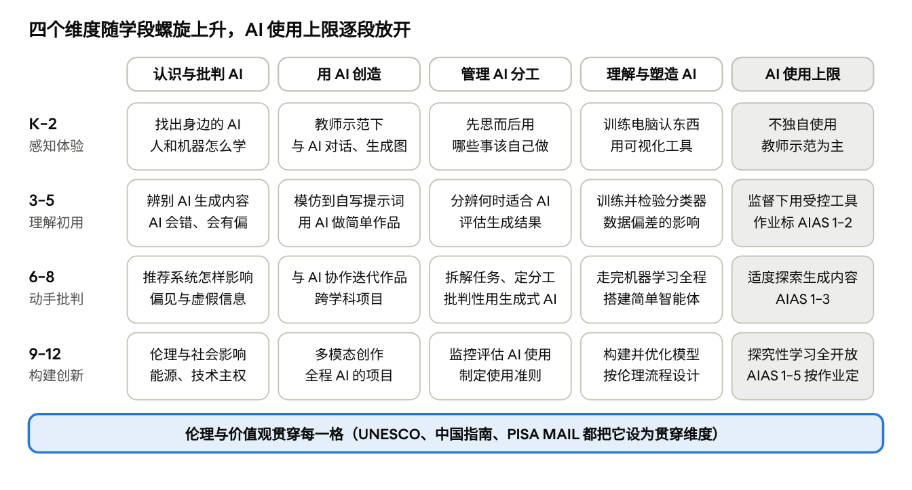

# K-12 AI 素养（AI Literacy）框架文献综述

Oct 25, 2026 · @Mike MA

## 一页纸核心结论

K-12 AI 素养没有"一个最好的框架"，但有一套可以直接组合的工具：用 UNESCO（2024）或 OECD/EC AILit（2026）定"学什么"，用 AI4K12 和香港/杭州的逐年示例定"什么时候"，用 AI Assessment Scale 定每份作业"用多少 AI"。

**思考这件事的五个方面**（也是本文献综述的结构）：

1. 维度（学什么）：认识与批判 AI、用 AI 创造、管理 AI 分工、理解与塑造 AI，伦理与价值观贯穿。
2. 学段（什么时候）：K-2 感知体验，3-5 理解并开始使用和训练模型，6-8 动手走完机器学习全程并批判性使用，9-12 构建系统并处理复杂伦理。
3. 使用层级（用多少）：政策按学段设上限，作业按 AIAS 五级标注。
4. 学校姿态（怎么组织）：AI 作为课程内容、作为学科工具、作为教学引擎、学生用 AI 创造；"AI 原生学校"是第三种，与 AI 素养教育是两件事。
5. 教师与评价（靠什么落地）：教师框架先行，用表现性任务测量。

**最前沿的文件（2025–2026）：** OECD/EC AILit 终版（2026 年 6 月，4 领域 19 条能力 × 3 级）；PISA 2029 媒介与 AI 素养测评框架首稿（2026，将首次在国际测评中考 15 岁学生的 AI 素养）；ETS 的 K-12 进阶与测评设计原则（2025 年 11 月）；中国教育部两份指南（2025 年 5 月）和香港教育局学习架构（2026 年 6 月，小二至小六逐年示例）；Yang 等（2026）首个按学段映射的系统综述。

**证据上最硬的几个结论：**

- "给答案"的 AI 会伤害学习，"给提示"的 AI 导师不会（约 1,000 名高中生的随机实验，PNAS 2025）。
- 一次 2 小时的 AI 素养课就能显著减少 13–15 岁学生对大模型的盲信（116 人对照，2026）。
- 让学生亲手训练分类器的课程有稳定的知识与伦理意识增益，从小学高年级起就可行。
- vibe coding 在 K-12 没有任何对照研究；大学生研究显示原型快但学生不读代码。它适合做创意项目的加速器，不适合替代编程基础。
- Alpha School 所有成效数据都是内部的，没有独立评估；唯一公开的公立数据（亚利桑那 Unbound Academy）低于州平均。Hinton 的赞赏是个人表态，不是证据。
- 各国都把学生独自使用生成式 AI 推到约 10–13 岁以后，与发展心理学上孩子对 AI 的心理模型在 12 岁左右从"天生聪明"转向"模式识别器"一致。

**文献的缺口也要知道：** 几乎没有面向小学的已验证测评工具；K-2 研究最少；所有进阶都是专家共识而非实证验证；UNESCO 和 AILit 都不绑定年级，排序的工作留给了学校。

关于您提到的"Dr. De Luca"：没有找到对应的 AI 素养框架，候选人选见下一节末尾。

## 什么是 AI 素养：概念演进与核心维度

2020 年以来的定义经历了三代：能力清单（Long & Magerko）、按 Bloom 分层（Ng 等）、生成式 AI 时代的提示与辨别能力。它们共享一个骨架：理解 AI、使用 AI、评估与创造、伦理；2025 年起的文献再加上自我反思和能动性。

**学术源头。** [Long & Magerko（CHI 2020）](https://doi.org/10.1145/3313831.3376727) 综述约 150 篇文献，给出被引最多的定义：AI 素养是"一组能力，使人能批判性地评估 AI 技术，与 AI 有效沟通与协作，并在网上、家里和工作中把 AI 当作工具"。论文用五个问题组织 17 项能力：AI 是什么？AI 能做什么？AI 如何工作？AI 应如何使用？人怎么看 AI？它还给出 15 条设计考量，其中"发展里程碑"一条指出心理理论、年龄和先前经验会影响儿童对 AI 的理解。[Ng 等（2021）](https://doi.org/10.1016/j.caeai.2021.100041) 综述 30 篇文献，按 Bloom 分类学提出四个层面：知道与理解、使用与应用、评估与创造，以及贯穿全部的 AI 伦理。这是 K-12 综述里的默认参照框架。

**生成式 AI 时代的补充。** 2023 年后的框架都在四层骨架上加入新能力：写提示词、辨别 AI 生成内容、核对幻觉、决定什么交给 AI。

| 框架 | 年份 | 维度 | 特点 |
| --- | --- | --- | --- |
| [Long & Magerko](https://doi.org/10.1145/3313831.3376727) | 2020 | 5 个问题下的 17 项能力 + 15 条设计考量 | 学术源头，覆盖正式与非正式学习 |
| [Ng 等](https://doi.org/10.1016/j.caeai.2021.100041) | 2021 | 知道理解 / 使用应用 / 评估创造 / 伦理 | 对应 Bloom 层级，最常用的课程骨架 |
| [Park](https://doi.org/10.1016/j.caeai.2025.100487) | 2025 | 上述四层 + 对 GenAI 的态度 | 51 项学校实证研究；学生最弱的是提示与批判评估 |
| [Zhang & Magerko](https://arxiv.org/abs/2504.19038) | 2025 | 12 条指南：选工具与提示 / 理解交互 / 理解输出 / 高层理解 | 点名幻觉、假共情、隐藏劳动、环境成本 |
| [Annapureddy 等](https://doi.org/10.1145/3685680) | 2024 | 12 项能力，含提示工程、辨别 AI 内容、法律、持续学习 | 面向公民，不分年龄 |
| [Anthropic AI Fluency](https://aifluencyframework.org/) | 2025 | 4D：授权 Delegation / 描述 Description / 辨别 Discernment / 尽责 Diligence | 产业框架，有教师与学生课程，未经同行评审 |
| [Bozkurt 3wAI](https://doi.org/10.55982/openpraxis.16.3.739) | 2024 | Know What / Know How / Know Why | 最简的三分法，适合向家长解释 |
| [Hossain 等 RAIL-Ed](https://arxiv.org/abs/2608.01705) | 2026 | 6 支柱 × 3 级：技术流畅、批判评估、人机协作、情境意识、伦理推理、能动性 | 批评旧框架把伦理当附加项 |
| [Yang 等](https://doi.org/10.1007/s41979-025-00166-z) | 2026 | 5 组件按学段映射：基础概念、创建 AI 作品、与 AI 代理交互、伦理意识、人机关系 | 首个系统映射学段进阶的综述（36 项研究） |

**综述文献点名的缺口**（2023–2026）：

- 定义仍然模糊，从幼儿园机器人到 ChatGPT 培训都叫"AI 素养"（[Gu & Ericson, ICER 2025](https://doi.org/10.1145/3702652.3744217)，124 项研究）。
- 几乎没有研究在教学后测量学生是否真的理解了 AI 概念（[Casal-Otero 等 2023](https://doi.org/10.1186/s40594-023-00418-7)，179 篇）；16 个已验证量表中只有 3 个是表现性测评，没有一个面向小学或幼儿（[Lintner 2024](https://doi.org/10.1038/s41539-024-00264-4)）。
- 框架很少说清每个学段该会什么；ETS 2025 的进阶是假设性的，尚未验证。
- K–2 和幼儿阶段研究最少，到 2022 年只有 16 项实证研究（[Su, Ng & Chu 2023](https://doi.org/10.1016/j.caeai.2023.100124)）。
- 伦理常被当成附加项，自我反怟与情感维度几乎缺席（[Zhou 等 2025](https://doi.org/10.1080/10494820.2025.2487538)）。
- 生成式 AI 时代的框架（AIAS、AI Fluency、3wAI）都是概念性的，K-12 有采用记录但没有效果证据。

**关于"Dr. De Luca"。** 中英文共六组检索没有找到一位与 K-12 AI 素养框架相关的 De Luca 博士。读音最接近的候选是：[Christopher DeLuca](https://educ.queensu.ca/for-teachers/popular-podagogy/ai-classroom)（女王大学，评估素养与 AI 评估）；[Chris Dede](https://www.gse.harvard.edu/directory/faculty/christopher-dede)（哈佛，"智能增强"视角）；Duri Long（上述 CHI 2020 论文第一作者）；Stefania Druga（儿童对 AI 的认知）。如果您记得学校提到的全名或机构，我可以定向补查。

## 主要国际框架对比

四个国际框架各有分工：UNESCO 给全球参照（4 维度 × 3 级），OECD/EC 的 AILit 给最新也最细的能力与进阶（4 领域 19 条能力 × 3 级），AI4K12 是唯一按 K-2 / 3-5 / 6-8 / 9-12 写技术内容的，Digital Promise 给"理解—评估—使用"的实践透镜。AILit 的终版自述综合了前三者，并对接 PISA 2029。

| 框架 | 发布 | 结构 | 进阶方式 | 绑定学段？ | 最适合用来 |
| --- | --- | --- | --- | --- | --- |
| [UNESCO 学生 AI 能力框架](https://www.unesco.org/en/articles/ai-competency-framework-students) | 2024.8，Miao、Shiohira & Lao | 4 维度（以人为本的心态、AI 伦理、AI 技术与应用、AI 系统设计）× 3 级（理解 / 应用 / 创造）= 12 块 | "跨年级的螺旋序列" | 否 | 国家课程对齐的全球参照 |
| [OECD/EC AILit](https://ailiteracyframework.org/pdfs/framework_pdf/AILF_en.pdf) | 2026.6 终版（2025.5 草案） | 4 领域（Engage / Create / Manage / Shape）下 19 条能力，每条标注知识、技能、态度 | 每条能力给 Basic / Intermediate / Advanced 三级期望和课堂情境 | 否，明说"不绑定年级或年龄" | 教学设计与评价；对接 PISA 2029 |
| [AI4K12 五大理念](https://ai4k12.org/gradeband-progression-charts/) | 2019 论文；进阶图 2020–2022 | 感知、表征与推理、学习、自然交互、社会影响 | 每条概念按 K-2 / 3-5 / 6-8 / 9-12 给学习目标 | 是 | 技术内容的年级排序；仍是工作草案，早于生成式 AI |
| [Digital Promise](https://digitalpromise.org/2024/06/18/ai-literacy-a-framework-to-understand-evaluate-and-use-emerging-technology/) | 2024.6，Mills、Ruiz 等 | 核心价值（人的判断、以公正为中心）+ 3 模式（理解 / 评估 / 使用）+ 3 类使用（互动 / 创造 / 解决问题）+ 6 项实践 | 举例式，不分级 | 否 | 学校领导的整合策略；低年级可不用 AI 工具先打基础 |
| [ETS 框架与进阶](https://rr.ets.org/index.php/etsrr/article/download/31/22/40) | 2025.11，Chakraburty、Ober & Liu | 4 子技能（获取与评估信息、沟通协作、创建内容、伦理决策）11 项指标 | 4 级：Emerging / Developing / Proficient / Exemplary | 否，侧重高中；未经验证 | 测评任务设计 |
| [中国教育部 2025 指南](https://www.eol.cn/zhengce/wenjian/202505/t20250512_2667827.shtml) | 2025.5 | 认知 / 技能 / 思维 / 价值观 | 小学 / 初中 / 高中三段 | 是 | 国家课程 |
| [香港教育局 2026 学习架构](https://www.edb.gov.hk/attachment/sc/curriculum-development/kla/technology-edu/curriculum-doc/IIT_Summary%20on%20AI_SC.pdf) | 2026.6 | 4 范围：认识 AI / 基本运作概念 / 应用与实践 / 反思与态度，8 个课题 | 小二至小六逐年级 | 是 | 最细的小学逐年示例 |
| [PISA 2029 MAIL 草案](https://www.oecd.org/en/about/projects/pisa-2029-media-and-artificial-intelligence-literacy.html) | 2026 首稿 | 5 能力：反思与负责任地行动（贯穿）、获取与使用、分析与评估、参与与协作、创造 | Low / Intermediate / High | 15 岁 | 国际测评；2031 年底出结果 |

**UNESCO 的 12 块。** 它的优点是把"以人为本"和"伦理"放在技术前面，并把"系统设计"单列为一维。

| 维度 | 理解 | 应用 | 创造 |
| --- | --- | --- | --- |
| 以人为本的心态 | 人的能动性 | 人的责任 | AI 时代的公民身份 |
| AI 伦理 | 具身伦理 | 安全与负责任的使用 | 伦理内嵌的设计 |
| AI 技术与应用 | AI 基础 | 应用技能 | 创建 AI 工具 |
| AI 系统设计 | 问题界定（包括何时不该用 AI） | 架构设计 | 迭代与反馈回路 |

**AILit 的 19 条能力。** 它的定义是：AI 素养是"在受 AI 影响的世界里蓬勃发展所需的技术知识、持久技能和面向未来的态度"。Engage 是基础领域，Create 与 Manage 并行，Shape 是最高层。

| 领域 | 能力（原文译） |
| --- | --- |
| Engage with AI（7） | 识别 AI 在不同情境的角色与影响；用消除误解的语言描述 AI 如何完成任务；判断 AI 输出应接受、修改还是拒绝；考察推荐系统如何扩展或限制视角；比较 AI 的能源与资源消耗；解释 AI 如何放大社会偏见；分析 AI 使用是否符合伦理原则与人类价值 |
| Create with AI（4） | 用 AI 探索新视角并在原创想法上构建；用不同类型的 AI 可视化、原型化、组合想法；指挥生成式 AI 获得反馈、优化结果并支持反思；分析 AI 如何保护或侵害内容真实性与知识产权 |
| Manage AI（4） | 根据任务性质决定是否用 AI；通过比较不同 AI 的运作方式选择合适的方案；拆解问题以决定何时、如何让 AI 自动化或增强任务；在解题全程监控并评估 AI 使用 |
| Shape AI（4） | 调查一个 AI 系统的设计意图、目标用户和局限；用既定标准、预期结果、测试用例和用户反馈评估 AI 系统；设计 AI 系统时关注数据来源、选择和信息流如何影响行为；改进 AI 系统以促进人类福祉与社会收益 |

与 2025 年草案相比，终版从 22 条合并为 19 条，"Designing AI"改名"Shape AI"，每条能力从"小学 / 中学情景"改为三级学习者期望。修订吸收了超过 100 个国家 2,000 多人的反馈。

**批评。** [Williamson（2025，NEPC 转载）](https://nepc.colorado.edu/node/13839) 指出 PISA 2029 会在出成绩之前就定义"什么算 AI 素养"，学校会为测试而教；[Couture 等（2025）](https://aihub.org/2025/10/13/why-we-should-be-skeptical-of-the-hasty-global-push-to-test-15-year-olds-ai-literacy-in-2029/) 认为 2029 年就测 15 岁学生"操之过急"，并质疑 TeachAI 顾问里的 Meta、OpenAI、微软等公司的角色。UNESCO 框架[尚未在非西方情境实证验证](https://research.mpu.edu.mo/en/publications/exploring-ai-competency-in-chinese-undergraduates-through-the-une/)；一项对 583 名中国大学生的研究支持四维结构，但发现低年级的技术得分反而高于高年级，挑战了线性进阶的假设。AI4K12 的进阶图自 2020–2022 年起没有定稿，对生成式 AI 几乎没有覆盖；对 Hour of Code 活动的映射显示绝大多数堆在"感知"和"学习"两条（[Morales-Navarro 等 2024](https://arxiv.org/abs/2412.11911)）。

## 从一年级到十二年级：分学段的进阶目标

真正按年级写目标的文件不多：AI4K12（技术内容，K-2 / 3-5 / 6-8 / 9-12）、香港教育局（小二至小六逐年）、杭州（1-2 / 3-4 / 5-6 / 初 / 高）、科罗拉多（K-5 / 6-8 / 9-12）、中国教育部（小 / 初 / 高）。把它们并排，脉络相当一致：低年级感知与体验，小学高年级开始训练模型和写提示词，初中走完机器学习全流程并批判式使用生成式 AI，高中构建系统并处理复杂伦理。

| 学段 | 技术理解（[AI4K12 进阶图](https://ai4k12.org/gradeband-progression-charts/)） | 使用与创造（[香港](https://www.edb.gov.hk/attachment/sc/curriculum-development/kla/technology-edu/curriculum-doc/IIT_Summary%20on%20AI_SC.pdf) / [杭州](https://m.thepaper.cn/newsDetail_forward_31451797) / [科罗拉多](https://www.coloradoedinitiative.org/wp-content/uploads/2025/08/Future-Ready-Colorado_Artificial-Intelligence-AI-K-12-Skills-Progression-Guide-for-Educators.pdf)） | 伦理与社会 | 生成式 AI 使用上限（政策） |
| --- | --- | --- | --- | --- |
| K-2（1–2 年级） | 找出设备上的传感器；描述人和计算机各自怎样学习；演示"训练计算机认出一样东西" | 香港小二：在教师监督下与 AI"对话"，知道它能用文字、图像、语音回应；杭州 1–2：认识校园常见 AI 应用，与智能设备简单互动 | 香港小二：认识过度依赖的不良影响；AI4K12：说出因自动化消失的工作；中国小学：隐私与数字身份的基本认知 | 中国：禁止独自使用开放式生成；新加坡：不布置任何需要 AI 的作业；日本：教师示范为主 |
| 3-5 年级 | 说明计算机感知与人的感知有何不同；训练一个分类模型并在新输入上检验准确率；为模型写 model card | 香港小三生成图像与音讯；小四模仿清晰提示词、辨识 AI 生成内容；小五用数据训练 AI 并分析数据偏差的影响；小六自主写提示词、评估生成结果、用 AI 设计解决方案；杭州 5–6：了解决策树、神经网络的基本结构 | 香港小六：明白 AI 可能生成错误和偏差，探讨人如何驾御 AI；科罗拉多 K-5："机器人该知道我的个人信息吗？" | 新加坡：小四起在教师监督下用教育部自建工具；NSW：5 年级起用 EduChat；中国：小学仍禁止独自开放生成 |
| 6-8 年级 | 对比人类学习与机器学习的独特之处；在表格数据上训练并评估分类或预测模型；举例说明智能体如何融合多传感器信息 | 中国初中：掌握机器学习基本流程与监督学习，通过智能体搭建完成场景应用；杭州：经历数据准备—训练—推理全流程，批判性使用生成式 AI；科罗拉多：用决策树等构建并评估简单模型，分析有偏数据集 | 中国初中：在生成式 AI 应用中辨析虚假信息风险；科罗拉多：偏见与公平、数据隐私 | 中国：可适度探索生成内容的逻辑性分析；英国：遵守工具年龄限制（多为 13 岁）并监督 |
| 9-12 年级 | 定义监督、无监督、强化学习并类比人的学习；用真实数据训练模型并评估结果；用伦理设计流程设计一个 AI 系统 | 中国高中：构建简易算法模型并优化，基于智能体开发跨学科方案；杭州：设计 AI 系统、开发智能体；科罗拉多：面向职业路径的 capstone 项目，区分窄 AI 与通用 AI | 中国高中：在复杂伦理情境中平衡创新与风险，审视技术主权；AI4K12：调查 AI 职业所需技能；科罗拉多：伦理与法律框架 | 中国：结合技术原理开展探究性学习；爱沙尼亚：10–11 年级全员 ChatGPT Edu；AIAS 五级均可用 |

**不绑定年级的框架怎么用。** UNESCO 的理解 / 应用 / 创造、AILit 的 Basic / Intermediate / Advanced、ETS 的四级、PISA 的 Low / Intermediate / High 都是熟练度级别，不是年龄。AILit 的理由是"学习者起点不同"；实际用法是同一条能力在每个学段都出现，只是要求的级别不同。例如 Engage 1（识别 AI 的影响）：基础级玩"是不是 AI"分类游戏，中级比较社交媒体的"为你推荐"页，高级分析聊天机器人的"连续打卡"和过度讨好是否为了提升使用时长而设计。

**发展心理学研究说孩子在每个年龄能懂什么。** 这是排序的依据，也解释了为什么各国都把独自使用生成式 AI 推到小学高年级以后。

| 年龄 | 研究发现 | 来源 |
| --- | --- | --- |
| 4–7 岁 | 能学会规则系统、简单监督学习和生成式 AI 的基本概念（80 名孩子，测评中位数 70%）；强烈拟人化，心理理论发展程度影响学习效果 | [Williams, Park & Breazeal（CHI 2019）](https://doi.org/10.1145/3290605.3300677)；[Druga 等（2017）](https://doi.org/10.1145/3078072.3084330) |
| 3–9 岁 | 能用 Teachable Machine 训练模型，并推理自己的动作与模型输出的关系 | [Vartiainen 等（2020）](https://doi.org/10.1016/j.ijcci.2020.100182) |
| 3–5 年级 vs 6–8 年级 | 低年级把 AI 的推理归为"天生聪明"，高年级开始把 AI 看作"模式识别器"（106 名学生） | [Dangol 等（2025）](https://arxiv.org/abs/2505.16031) |
| 7–12 岁 | 四国 102 名孩子：美国以外的孩子更怀疑 AI；家庭社经地位影响概念掌握 | [Druga 等（2019）](https://doi.org/10.1145/3311890.3311904) |
| 11–18 岁 | 对生成式 AI 的概念理解中等，但提示工程和批判性评估输出是最弱的两项（51 项学校研究综述） | [Park（2025）](https://doi.org/10.1016/j.caeai.2025.100487) |

综合起来的年龄脉络：5–8 岁靠具身、可触摸的活动理解"教机器"；9–11 岁能训练和检验分类器，但多数仍把 AI 当作"聪明的机器人"；12–14 岁转向机制性理解，可以做数据驱动的设计项目；15–18 岁能抽象讨论伦理、用代码构建。

## "用多少 AI"的层级：AI Assessment Scale 与同类框架

这类框架回答的不是"学生懂多少 AI"，而是"这份作业允许用多少 AI"。最成熟的是 AI Assessment Scale（AIAS），已被澳洲、巴拿马等地多所 K-12 学校采用，但还没有学习效果证据。

**AIAS 的两个版本。** [Perkins, Furze, Roe & MacVaugh（2024）](https://arxiv.org/abs/2312.07086) 的原版为高校设计，作者自评"足够灵活，可用于 K-12"；[2025 年修订版](https://arxiv.org/abs/2412.09029)去掉了红绿灯式的从低到高暗示，强调五级没有好坏，只是适合不同的学习目标。

| 级 | 原版（2024） | 修订版（2025） | 课堂含义 |
| --- | --- | --- | --- |
| 1 | No AI | No AI | 只有在没有数字设备的环境里才真正可执行，如课堂手写。 |
| 2 | AI 辅助构思与结构 | AI 辅助计划（构思、检索、规划） | AI 可用于前期，产出必须是学生自己写的。 |
| 3 | AI 辅助编辑 | AI 辅助完成任务 | 承认 AI 参与起草；评价重心转向学生的批判评估和自己的声音。 |
| 4 | AI 完成任务，人评估 | Full AI | 策略性全程使用 AI，可多模态；考的是指挥与判断。 |
| 5 | Full AI | AI 探索 | 师生共同创造新的方法与媒介，作者自称"有意面向未来"。 |

K-12 的改编版来自共同作者 Leon Furze：他的[学校版](https://leonfurze.com/2023/12/18/the-ai-assessment-scale-version-1/)把五级改成"不用 AI / 头脑风暴 / 提纲与笔记 / 反馈与编辑 / 全程 AI"，并[记录了多所学校的做法](https://leonfurze.com/2024/05/20/the-ai-assessment-scale-in-action-examples-from-k-12-and-higher-education-across-the-world/)。典型用法是每份作业标注一个级别，让"用多少 AI"成为教学设计的一部分而不是事后的诚信问题。[批评者](https://jeremierostan.substack.com/p/leon-furzes-ai-assessment-scale-a)认为它把复杂的学习过程压成了一条标尺。

**同一个问题的其他回答。** OECD/EC AILit 的 Manage AI 1 能力就是"根据任务性质决定是否用 AI"，进阶是：基础级按教师规则匹配工具；中级在教室四角"只用 AI / AI 辅助 / 只用人 / 不确定"中站队并辩护；高级把写作文拆成步骤，判断哪步可以交给 AI。Anthropic 的 [AI Fluency](https://aifluencyframework.org/) 用四个 D 描述同一件事：授权（是否、何时、如何用 AI）、描述（把目标说清楚）、辨别（判断输出好坏）、尽责（对结果负责），并区分自动化、增强、代理三种人机关系。[Mollick & Mollick（2023）](https://papers.ssrn.com/abstract=4475995) 的七种角色（导师、教练、导师、队友、工具、模拟器、学生）则是从"AI 在这次作业里扮演什么"的角度切入。

**国家层面的"使用层级"是按学段划的。** 中国 2025 年指南：小学禁止独自使用开放式生成，初中适度探索生成内容的逻辑性分析，高中结合技术原理探究。新加坡：小一至小三不布置需要 AI 的作业，小四起只用教育部自建并限次的工具。香港把原则写成学生能记住的句子："先思而后用"、"学会分辨甚么时候需要人工智能协助，甚么时候应该由自己完成"。

对学校的含义：使用层级应该同时出现在两个尺度上，一是按学段划定的上限（政策层），二是每份作业标注的级别（教学层）。两者都要让学生知道为什么这样划。

## 用 AI 学 vs. 用 AI 做：项目式学习、学生创建 AI 与 vibe coding

两条路线的证据差别很大：让学生亲手训练分类器、搭建 AI 应用的课程有稳定的前后测增益，而 vibe coding 在 K-12 阶段至今没有任何对照研究。

**三种"用 AI"要分开看。** OECD/EC 的 AILit 框架（2026）把"用"拆成三个领域：Create with AI（把 AI 当创作伙伴但保留人的主导）、Manage AI（决定哪些步骤交给 AI、哪些自己做）、Shape AI（理解并改进 AI 系统本身）。[Ouyang & Jiao（2021）](https://doi.org/10.1016/j.caeai.2021.100020) 的三范式给出同一条轴：AI-directed（学生是接受者）、AI-supported（学生是协作者）、AI-empowered（学生是主导者）。学校规划时值得问：我们的项目落在哪一格。

**学生"做 AI"的成熟资源**（按起始年级排序）：

| 资源 | 年级 / 年龄 | 学生做什么 | 组织 |
| --- | --- | --- | --- |
| [Day of AI](https://dayofai.org) | PreK–12，逐年级 | 分析深伪、数据偏见、ChatGPT 在学校的使用；设计并批评 AI 系统 | MIT RAISE，175 国、500 万+学生 |
| [Hands-On AI Projects for the Classroom](https://iste.org/ai) | 小学到高中，5 本指南 | 做聊天机器人、机器学习小游戏、机器人路径规划 | ISTE + GM（2021） |
| [Machine Learning for Kids](https://machinelearningforkids.co.uk) | 约 8 岁起 | 训练文本/图像/声音模型，接入 Scratch、App Inventor、Python | Dale Lane（IBM） |
| [Teachable Machine](https://teachablemachine.withgoogle.com) | 小学高年级起 | 浏览器里无代码训练图像/声音/姿态分类器，导出到 Scratch | Google |
| [AI with App Inventor](https://appinventor.mit.edu/explore/ai-with-mit-app-inventor) | 3–12 年级，主要 6–12 | 做图像分类 App、ChatGPT/DALL-E 小应用、强化学习小游戏 | MIT |
| [DAILy](https://raise.mit.edu) | 10–14 岁，约 30 课时 | 训练分类器、生成 GAN 艺术、讨论伦理与 AI 职业 | MIT RAISE |
| [Experience AI](https://experience-ai.org) | 11–14 岁 | 6 节基础课 + 大语言模型、AI 安全单元；训练分类器并批评数据 | Raspberry Pi 基金会 + Google DeepMind |
| [Common Sense AI Literacy](https://www.commonsense.org/education/ai-literacy) | 6–12 年级 | 媒介与 AI 素养课，嵌入数字公民课程 | Common Sense Media |
| [aiEDU Intro to AI](https://www.aiedu.org/educator-resources-1) | 9–12 年级，36 课 | 项目式，用 Hugging Face 无代码工具做项目 | aiEDU |
| [CodeAI AI Foundations](https://code.org/curriculum/artificial-intelligence-foundations) | 9–12 年级，一学期 | 数据与社会、网络安全、负责任的 AI 设计，第二学期"用 AI 设计与构建" | CodeAI（原 Code.org） |
| [Stanford CRAFT](https://craft.stanford.edu) | 高中，跨学科 | 在艺术、数学、历史、英语课里探索、质疑、批评 AI | Stanford GSE / HAI |
| [Hour of AI × Lovable](https://imagilabs.com/pages/hour-of-code-vibe-coding) | 3–12 年级 | 用自然语言描述一个游戏，由 Lovable 生成并迭代 | CodeAI / imagi（2025 年 12 月起） |

**Vibe coding 是什么，K-12 怎么用。** 这个词由 Andrej Karpathy 于 [2025 年 2 月提出](https://x.com/karpathy/status/1886192184808149383)：完全交给 AI 生成代码，自己不读 diff，"大体上能用"。2025 年 11 月它成为柯林斯词典年度词。K-12 的落地主要是两类：学生用 Lovable、Replit 等工具把想法变成可运行的小程序（如 Hour of AI 的课程），以及教师自己 vibe coding 做课堂小工具。CoSN 的 2026 年指引用一句话概括风险边界："[鼓励车库里的实验，但保护校车](https://www.cosn.org/vibe-coding-in-k-12-innovation-guardrails-and-the-school-bus/)"，即学生练手可以，涉及学生数据的正式系统不行。

**研究说了什么。** 现有研究全部在大学生层面：[Geng 等（2025）](https://arxiv.org/abs/2507.22614) 发现学生用 Replit 时主要让 AI 测试和调试，很少读代码；[Gama 等（ICSE-SEET 2026）](https://arxiv.org/abs/2512.02750) 的一日黑客松显示原型快、信心高，但过早收敛、代码质量参差。面向 K-12 教师的 [GAIDE 框架（2026）](https://arxiv.org/abs/2607.05406) 用 8 周工作坊证明"边做边学"能提升教师的 AI 素养，样本只有 3 人。截至 2026 年 10 月，没有任何关于 K-12 学生 vibe coding 学习效果的对照研究。

**"用 AI 学"的护栏证据最硬。** [Bastani 等（PNAS 2025）](https://www.pnas.org/doi/10.1073/pnas.2422633122) 对约 1,000 名土耳其高中生做随机实验：直接给答案的 GPT 让练习成绩涨 48%，但闭卷考试反而比对照组低 17%；只给提示的 GPT Tutor 版本把这个伤害抹平了。[Clerc 等（AIED 2026）](https://arxiv.org/abs/2604.01955) 对 116 名 13–15 岁学生做对照：一次 2 小时的 AI 素养工作坊就显著减少了对大模型的盲信。MIT 的 ["Your Brain on ChatGPT"](https://arxiv.org/abs/2506.08872) 常被引用，但只有 54 名成年参与者，是预印本。

**"用 AI 做"的学习增益可复现。** [Lee 等（SIGCSE 2021）](https://dl.acm.org/doi/10.1145/3408877.3432513) 的 DAILy 课程让初中生在机器学习知识、职业兴趣、伦理意识上都有显著前后测提升；[Martins 等（IJAIED 2024）](https://eric.ed.gov/?id=EJ1426295) 让 108 名巴西中学生用 Teachable Machine 做垃圾分类识别器，不论年级和性别都掌握了核心概念。这些研究多数没有对照组，但方向一致。

对学校的含义：先把"AI 给答案"换成"AI 给提示"；把亲手训练模型放在初中；vibe coding 适合作为创意项目的加速器，不宜替代编程基础教学。

## 学校模式分类：从"AI 作为课程内容"到"AI 原生学校"

文献里没有一套公认的"学校 AI 模式"分类；最常用的是 Holmes 等人的三分法（学 AI / 用 AI 学 / 为 AI 时代做准备），再叠加学生能动性的三范式。Alpha School 代表"AI 主导教学"那一端，至今没有任何独立评估。

**文献中的分类框架**（每个回答不同的问题）：

| 框架 | 提出者 | 类别 | 回答什么问题 |
| --- | --- | --- | --- |
| 学 AI / 用 AI 学 / 为 AI 做准备 | [Holmes 等（2022，欧洲理事会）](https://rm.coe.int/artificial-intelligence-and-education-a-critical-view-through-the-lens/1680a886bd)；[UNESCO 2021 政策指南](https://unesco.org.uk/site/assets/files/10385/ai_and_education_-_guidance_for_policy-makers.pdf) 采用 | learning about AI / learning with AI / preparing for AI | 学校"教 AI"的目的是什么 |
| 四个"学" | [新加坡教育部](https://www.moe.gov.sg/education-in-sg/educational-technology-journey/edtech-masterplan/artificial-intelligence-in-education) | learn about / to use / with / beyond AI | 同上，多了"超越 AI"（人的独特能力） |
| 三范式 | [Ouyang & Jiao（2021）](https://doi.org/10.1016/j.caeai.2021.100020) | AI-directed / AI-supported / AI-empowered | 学生在人机关系中是接受者、协作者还是主导者 |
| 面向学生 / 教师 / 机构 | [Baker 等（Nesta 2019）](https://media.nesta.org.uk/documents/Future_of_AI_and_education_v5_WEB.pdf)；[Holmes & Tuomi（2022）](https://doi.org/10.1111/ejed.12533) | 智能导师、自动评分 / 课堂编排、教学助手 / 招生、排课、辍学预测 | AI 工具服务于谁 |
| 七种角色 | [Mollick & Mollick（2023）](https://papers.ssrn.com/abstract=4475995) | AI-tutor / coach / mentor / teammate / tool / simulator / student | 一次作业里 AI 扮演什么 |
| SAMR | Puentedura；[2026 实证综述](https://www.openu.ac.il/Lists/MediaServer_Documents/innovation/chais/2026/a1_4.pdf) | 替代 / 增强 / 修改 / 重构 | 技术改变教学的深度；多数 GenAI 使用停在"增强" |
| PICRAT | [Kimmons, Graham & West（2020）](https://citejournal.org/volume-20/issue-1-20/general/the-picrat-model-for-technology-integration-in-teacher-preparation/) | 学生被动/互动/创造 × 教师替代/放大/变革 | 学生和教师两侧的变化幅度 |

**用这些轴看，学校的实际做法落在四种姿态**（本综述的归纳）：

| 姿态 | 核心做法 | 典型例子 | 证据状况 |
| --- | --- | --- | --- |
| A. AI 作为课程内容（学 AI） | 独立课或融入信息科技/科学课 | 北京每学年 ≥8 课时；阿联酉 KG–12 必修；CodeAI AI Foundations | 分类器实操课程有前后测增益（上节） |
| B. AI 作为学科工具（用 AI 学，教师主导） | 给学生受控的 AI 工具，教师设计任务 | [爱沙尼亚 AI Leap](https://hm.ee/en/news/estonia-announces-groundbreaking-national-initiative-ai-leap-programme-bring-ai-tools-all)（10–11 年级）；新加坡 SLS Learning Assistant（小四起）；[NSW EduChat](https://www.nsw.gov.au/ministerial-releases/nsw-to-roll-out-purpose-built-ai-education-tool-to-all-public-school-students-from-year-5)（5–12 年级） | 随机实验支持"给提示"的导师模式，反对"给答案" |
| C. AI 作为主要教学引擎（AI-directed） | 自适应软件承担大部分学科教学，教师变"引导者" | [Alpha School](https://en.wikipedia.org/wiki/Alpha_School) / Timeback；Unbound Academy；[松鼠 AI](https://sri.com/publication/education-learning-pubs/when-adaptive-learning-is-effective-learning-comparison-of-an-adaptive-learning-system-to-teacher-led-instruction) | 零独立评估；唯一公开数据（Unbound 亚利桑那）低于州均 |
| D. 学生用 AI 创造（AI-empowered） | 做分类器、App、vibe coding 项目 | App Inventor、Day of AI、Hour of AI × Lovable | 前后测增益稳定；vibe coding 无 K-12 对照研究 |

大多数学校是 A + B + D 的组合。有争议的是 C：它替代的不是某一节课的工具，而是教师的授课角色。

**Alpha School 到底是什么。** 它 2014 年在德州奥斯汀由 MacKenzie Price 和 Brian Holtz 创办，前身是 Acton Academy 的分支，资金来自 Trilogy 创始人 Joe Liemandt。每天约 2 小时用自适应掌握式软件学学科（一位家长的[长文评测](https://www.astralcodexten.com/p/your-review-alpha-school)指出约 80% 是 IXL，另有 Beast Academy、Amira、Duolingo 和自研应用），下午是生活技能工作坊；校内没有持证教师，只有"引导者"，学生完成达标课程可获得代币奖励，还有远程教练和眼动/点击追踪。创办人自己说，这里的"AI"主要是自适应学习，而不是大语言模型。

学费从 1 万到 7.5 万美元不等，常见约 4 万美元；2026 年有约 13–14 个校区，[Axios](https://www.axios.com/2026/08/02/alpha-schools-ai-expansion-50-campuses) 报道计划扩到 50 个，[Fortune](https://fortune.com/2026/09/10/alpha-school-wealthy-parents-ai-school/) 报道学生超过 1,200 人。它的对外说法是"2 小时学 2 倍"、MAP 测试前 1–2%。Geoffrey Hinton 在 2026 年 1 月 BBC Newsnight 里被问到自己引以为傲的 AI 应用时点名了 Alpha School（[报道](https://www.aol.com/articles/godfather-ai-says-pricey-private-102301273.html)）；他早前还说过 AI 导师可能比私教"好三到四倍"。

**证据与争议**：

- 所有成效数据都是校方内部的 MAP 分析，没有同行评审或独立评估；Brookings 的 Rebecca Winthrop 称其"实验性"。
- 招生筛选"可教性"和纪律记录，样本本身有选择效应（[Dan Meyer, 2026](https://danmeyer.substack.com/p/does-alpha-school-work-for-regular)）。
- 家长评测者指出学科时间实际约 3.5 小时；用同一套软件但没有引导者和奖励的在家试点只有正常增长，说明起作用的是"整套机制"而不是软件。
- 监管机构持保留态度：宾夕法尼亚教育部以"未经验证"为由[拒绝了 Unbound 的特许网校申请](https://chalkbeat.org/philadelphia/2025/01/29/pennsylvania-rejects-ai-cyber-charter-school-unbound-academy-application)；德州、北卡、阿肯色、犹他也否决了关联特许学校。
- 神经科学家 Jared Cooney Horvath 等提出屏幕时间与认知发展的担忧（Fortune）。

唯一的公立数据来自亚利桑那的 Unbound Academy（2025 年秋开学的免费在线特许学校，4–8 年级，用同一套 2 Hour Learning 模式）的首年州测：

| 学科 | Unbound 达标率 | 特许合同目标 | 亚利桑那州平均 |
| --- | --- | --- | --- |
| 数学 | 10% | 60% | 34% |
| 英语语文 | 28% | 65% | 42% |

来源：[Dan Meyer（2026 年 8 月）](https://danmeyer.substack.com/p/does-alpha-school-work-for-regular)。休斯敦学区 2026 年 8 月起在两所小学试点 Timeback（教师仍是责任教师，[报道](https://www.houstonpublicmedia.org/articles/education/2026/08/03/558564/hisd-ai-learning-alpha-school-timeback-future-2-gregg-martinez-elementary/)），是这套模式第一次进入公立体系的可观察试点。

**对家长和学校的含义：** "AI 原生学校"与"AI 素养教育"是两件事。前者是用 AI 重组教学组织方式，后者是把 AI 本身变成学生要掌握的能力。Alpha School 的学生并不因此自动获得更高的 AI 素养；一所普通学校也可以在不改变教学组织的前提下把 A、B、D 做得很好。

## 各国政策动向（2023–2026）

各国政策有三个共性：生成式 AI 的独立使用普遍推到约 10–13 岁以后，且走受控工具；素养都按"理解 / 使用 / 评估 / 伦理"四块框定；学段进阶都是"感知体验 → 理解应用 → 创造创新"的螺旋。治理方式则分化：中国、阿联酉、印度强制开课，美国、澳大利亚靠非约束性指南，欧盟靠 AI 法案第 4 条的法律义务。

| 国家 / 地区 | 关键文件 | 学段规定（含生成式 AI） | 强制性 / 课时 |
| --- | --- | --- | --- |
| 中国（国家） | [教育部《关于加强中小学人工智能教育的通知》](http://www.moe.gov.cn/jyb_xwfb/gzdt_gzdt/s5987/202412/t20241202_1165500.html)（2024.11）；[《中小学人工智能通识教育指南（2025 年版）》](https://www.eol.cn/zhengce/wenjian/202505/t20250512_2667827.shtml)；[《中小学生成式人工智能使用指南（2025 年版）》](https://m.thepaper.cn/newsDetail_forward_30802716)；[《"人工智能+教育"行动计划》](http://www.moe.gov.cn/srcsite/A16/s3342/202604/t20260410_1433240.html)（2026.4） | 小学低年级感知体验，小学高年级和初中理解应用，高中项目创作；小学禁止学生独自使用开放式内容生成，初中适度探索，高中探究性学习 | 2030 年前基本普及；2026 年要求各地明确各学段课时 |
| 北京 | [《北京市推进中小学人工智能教育工作方案（2025—2027 年）》](https://www.bjnews.com.cn/detail/1741356871129813.html) | 小学体验式，初中认知类，高中综合实践；四模块：基本概念、应用与技术、实现方法、伦理与社会 | 2025 年秋起全市每学年 ≥8 课时，计入综合素质评价 |
| 浙江 / 杭州 | [《浙江省中小学人工智能通识教育指导意见》](https://www.thepaper.cn/newsDetail_forward_31882565)（2025）；[《杭州市中小学人工智能教育地方课程纲要（试行）》](https://m.thepaper.cn/newsDetail_forward_31451797) | 小学"感知—体验—创造"，初中"理解—应用—协同"，高中"探究—创新—融通"；杭州按 1–2 / 3–4 / 5–6 年级细分 | 杭州每学年 ≥10 课时 |
| 香港 | [《中小学人工智能素养学习架构》](https://www.edb.gov.hk/attachment/sc/curriculum-development/kla/technology-edu/curriculum-doc/IIT_Summary%20on%20AI_SC.pdf)（2026.6） | 小二起逐年课题：小二在教师监督下与 AI"对话"，小三生成图像音讯，小四辨识 AI 生成内容，小五训练模型，小六自主写提示词 | 2026/27 学年随小学资讯与创新科技课程推出 |
| 美国（联邦） | [行政令 14277](https://www.whitehouse.gov/presidential-actions/2025/04/Advancing-Artificial-Intelligence-Education-For-American-youth/)（2025.4）；[教育部 Dear Colleague 信](https://www.ed.gov/about/news/press-release/us-department-of-education-issues-guidance-artificial-intelligence-use-schools-proposes-additional-supplemental-priority)（2025.7） | 不定义 AI 素养；设总统 AI 挑战赛，按小学/初中/高中分组 | 非强制；[35 州+波多黎各有指南](https://www.aiforeducation.io/ai-resources/state-ai-guidance)（2026.8）；[俄亥俄州](https://education.ohio.gov/Topics/AI-in-Ohio-s-Education/Model-Policy)要求 2026.7.1 前每学区有 AI 政策；[加州 AB 2876](https://calmatters.digitaldemocracy.org/bills/ca_202320240ab2876) 把 AI 素养写进课程框架 |
| 欧盟 | [AI 法案第 4 条](https://digital-strategy.ec.europa.eu/en/policies/ai-talent-skills-and-literacy)（2025.2.2 生效）；DigComp 2.2；AILit 框架（2026.6） | 对"部署者"（含学校）的 AI 素养义务；AILit 三级进阶不绑定年龄 | 法律义务而非课程强制；[2026 Omnibus](https://ki-campus.org/en/blog/eu-ai-act-ai-omnibus-recalibrates-article-4-ai-literacy-remains-mandatory) 放宽为"采取措施" |
| 英国 | [DfE《Generative AI in education》](https://www.gov.uk/government/publications/generative-artificial-intelligence-in-education/generative-artificial-intelligence-ai-in-education)（2025.8 更新）；[JCQ 评估指引](https://www.jcq.org.uk/wp-content/uploads/2025/04/AI-Use-in-Assessments_Apr25_FINAL.pdf)（2025.4） | 遵守工具年龄限制，监督与过滤；考试中 AI 生成部分不得分 | [2028 年新课程](https://www.bcs.org/articles-opinion-and-research/reformed-school-curriculum-will-feature-ai-media-literacy-and-a-new-computing-gcse/)纳入 AI 素养与新计算 GCSE |
| 新加坡 | [EdTech Masterplan 2030](https://www.moe.gov.sg/education-in-sg/educational-technology-journey/edtech-masterplan)；[国会答复 2026.5](https://www.moe.gov.sg/news/parliamentary-replies/20260506-ai-usage-in-schools) | 小一至小三不布置任何需直接用 AI 的作业；小四起在教师监督下用 MOE 自建 SLS 工具；国考禁用 | 小四起必修 10 小时 Code for Fun 含 AI 入门；选修两个 5 小时 AI for Fun |
| 澳大利亚 | [《Australian Framework for GenAI in Schools》](https://www.education.gov.au/schooling/announcements/australian-framework-generative-artificial-intelligence-ai-schools)（2023）；ACARA AI 课程连接；[NSW EduChat](https://www.nsw.gov.au/ministerial-releases/nsw-to-roll-out-purpose-built-ai-education-tool-to-all-public-school-students-from-year-5) | 6 项原则；NSW 5–12 年级全员使用受控工具 | 非强制、"愿景性" |
| 日本 | [MEXT 生成 AI 利活用指南 Ver.2.0](https://www.mext.go.jp/a_menu/other/mext_02412.html)（2024.12） | 小学生直接使用需"更慎重判断"，建议教师示范；遵守年龄条款与家长同意；考试禁用 | 指南，非强制 |
| 韩国 | AI 数字教科书（2025.3 起）→ [2025.8 修法降为"教育资料"](https://www.koreaherald.com/article/10546695) | 小三四、初一、高一英语数学先行 | 强制推行受滉，小学采用率约 30% |
| 爱沙尼亚 | [AI Leap](https://hm.ee/en/news/estonia-announces-groundbreaking-national-initiative-ai-leap-programme-bring-ai-tools-all)（2025.9 起） | 10–11 年级全员 ChatGPT Edu，教师先培训 | 国家项目，2026 年扩至职校 |
| 印度 | [CBSE AI 技能模块](https://news.careers360.com/18839-cbse-schools-offer-artificial-intelligence-as-a-skill-subject-from-class-6-nep-2020-recommendations-education-ministry) 6 年级起 | 2027–28 学年起 9 年级必修"AI 与计算思维" | 18,839 所学校开设 |
| 阿联酉 | [内阁批准 KG–12 必修 AI](https://www.wam.ae/en/article/bji6z2n-ministry-education-introduces-curriculum-public)（2025.5） | KG 故事游戏 → Cycle 1 人机对比 → Cycle 2 设计训练、偏见 → Cycle 3 提示工程 | 不增课时，嵌入计算课 |

**中国的四位一体素养。** 教育部 2025 年指南把人工智能素养定为认知、技能、思维、价值观四位一体，按"分层递进、螺旋上升"设计。小学"侧重体验与兴趣培养"，掌握简单工具操作和可视化编程；初中"理解技术逻辑"，掌握机器学习基本流程并通过智能体搭建完成应用；高中"强化技术战略"，构建简易算法模型并开发跨学科解决方案。配套的使用指南对教师也有红线："不得将生成式人工智能作为替代性教学主体"，禁止直接用 AI 回答学生问题或评价学生。

**美国的路径是自上而下的倡议加各州自定。** 行政令设立白宫 AI 教育工作组，要求部门为 K-12 提供"基础 AI 素养与批判性思维"资源；2026 年首届总统 AI 挑战赛有超过 2 万学生参加。州层面的指南几乎全部非约束性，[CRPE 2026 年的简报](https://crpe.org/wp-content/uploads/SEA-Brief-2026-v1.pdf)指出 20 个先行州中 16 个发了指南。加州 AB 2876 给了一个法定定义：AI 素养是关于"AI 如何工作，包括其原理、概念、应用、局限、影响与伦理考量"的知识、技能与态度。

**韩国是反面案例。** 它把 AI 数字教科书当成法定教材强推，2025 年 8 月国会修法把它降为学校自愿采用的"教育资料"。它说明"工具先行"的强制推广在政治上很脆弱，而从素养目标出发的课程路径更稳。

## 教师能力与学校实施路径

所有框架都承认同一件事：学生的 AI 素养受限于教师的 AI 素养。UNESCO 2024 年指出，到 2022 年全球只有约 7 个国家有面向教师的 AI 框架或项目。

**教师框架。** [UNESCO 教师 AI 能力框架](https://www.unesco.org/en/articles/ai-competency-framework-teachers)（Miao & Cukurova 2024）是 5 维度 × 3 级 = 15 项能力：以人为本的心态、AI 伦理、AI 基础与应用、AI 教学法、AI 用于专业发展，级别为获得 / 深化 / 创造。浙江省和杭州市 2025 年的[教师人工智能素养框架](https://m.thepaper.cn/newsDetail_forward_31451797)用五个维度：意识与思维、知识与技能、育人与教学、研究与发展、伦理与安全。中国 2026 年的行动计划要求"将人工智能纳入教师资格考试和认证内容"。

**学校层面的工具。** [TeachAI 工具包](https://www.teachai.org/toolkit)（2023，Code.org、CoSN、Digital Promise 等）给出七条原则和政策模板，其中一条就是"促进 AI 素养"；[CoSN/CGCS 的 K-12 生成式 AI 成熟度工具](https://www.cosn.org/?p=16637)把"学业 AI 素养准备度"单列为七个评估领域之一。AILit 特别提醒：AI 素养覆盖面很宽，"一位教师包攀全部并不现实"，需要跨学科分工。

**教师培训的规模与证据。** MIT 的 Day of AI 已培训约 7 万教师，ISTE+ASCD 与 Google 2026 年启动[面向 600 万美国教师的 AI 素养培训](https://iste.org/news/iste-ascd-and-google-partner-to-provide-ai-literacy-training-to-six-million-u-s-educators)，爱沙尼亚 AI Leap 坚持"教师先培训、学生后使用"。英国 DfE 的判断是教师端的 AI 使用"收益更直接、风险更少"，这也是多数学校的起点。

**一条可执行的路径**（综合 TeachAI、AILit、Digital Promise 和各国指南的共识）：

1. 盘点现状：学校现在处于上节四种姿态的哪几种，哪些年级已在用哪些工具。
2. 选定素养框架：用 UNESCO 或 AILit 定维度，用 AI4K12 和香港/杭州的逐年示例定排序。
3. 制定使用规则：按学段定生成式 AI 的上限，每份作业标注 AIAS 级别，并向学生解释为什么。
4. 教师先行：先让教师用 AI 备课和设计任务，再开放学生端；按教师框架设定培训目标。
5. 选择受控工具：优先"给提示不给答案"的导师模式，遵守年龄限制，不输入学生个人数据。
6. 把"做 AI"放进课程：小学高年级起训练分类器，初中走完机器学习全流程，高中做有伦理设计环节的项目。
7. 测量与回馈：用表现性任务做前后测，因为现有量表没有一个面向小学；每年回看规则。
8. 家校沟通：把学段上限和作业级别说给家长，并说明在家中如何配合。

## 给学校的整合模型建议

把前面的文献压成一张图：横向是"学什么"（AILit 的四个领域），纵向是"什么时候"（四个学段），最右一列是"用多少"（政策上限 + AIAS 作业级别），伦理与价值观作为底座贯穿。学校的每一门课、每一个项目都应该能定位到图中的某几格。

从上往下读，每一列都是同一种能力在四个学段的加深；从左往右读，是从"看懂 AI"到"改变 AI"的角色升级；最右一列的上限每段放开一点。每格的详细目标见前文"从一年级到十二年级"一节的表。

**三条轴的来源。** 维度轴取 OECD/EC AILit（2026）的 Engage / Create / Manage / Shape，因为它最新、最细、且自述综合了 UNESCO、Digital Promise 和 AI4K12；伦理底座来自 UNESCO 的"以人为本"、中国指南的"价值观"和 PISA MAIL 的"反怟与负责任地行动"，三者都把它设为贯穿维度。学段轴是 AI4K12、香港、杭州和教育部文件的公共脊线。使用上限轴把政策层（中国、新加坡等按学段的规定）和教学层（AIAS 每份作业标级）合在一起。

**怎么用这张图。** 把学校现有的每个 AI 相关活动填进格子，空白的格子就是缺口。三个例子：

- "五年级用 AI 为自己写的童话配插图" → 3–5 × 用 AI 创造，监督下的受控工具，作业标 AIAS 2。
- "初二用 Teachable Machine 做校园垃圾分类识别器" → 6–8 × 理解与塑造 AI，同时触及"认识与批判"里的数据偏见。
- "高二用 Lovable 做一个校园活动 App" → 9–12 × 用 AI 创造 + 管理 AI 分工，AIAS 4；如果要求学生评估它的局限和数据安全，就也进入"塑造 AI"。

**学校要回答的五个问题：**

1. 我们覆盖了四个维度，还是只有"用"？多数学校停在 Engage 和 Create，Manage 和 Shape 空缺。
2. 每个学段的生成式 AI 上限写清楚了吗，学生和家长知道为什么吗？
3. "做 AI"从几年级开始？文献支持小学高年级训练分类器，初中走完全流程。
4. 教师的框架和培训是什么？没有教师层，学生层不会发生。
5. 怎么知道有效？用表现性任务前后测，而不是用量或满意度。

## 参考文献与资源

以下为本文实际打开并引用的来源，按类别排列；正文中的链接均指向这些页面。

**国际框架**

- OECD / European Union (2026). [Empowering Learners for the Age of AI: An AI Literacy Framework for Primary and Secondary Education](https://ailiteracyframework.org/pdfs/framework_pdf/AILF_en.pdf). doi 10.1787/65cd27d4-en。网站：[ailiteracyframework.org](https://ailiteracyframework.org/)。
- UNESCO (2024). [AI competency framework for students](https://www.unesco.org/en/articles/ai-competency-framework-students)（Miao, Shiohira & Lao）；[AI competency framework for teachers](https://www.unesco.org/en/articles/ai-competency-framework-teachers)（Miao & Cukurova）。
- AI4K12 (2019–2022). [Grade band progression charts](https://ai4k12.org/gradeband-progression-charts/)；Touretzky 等 (2019) [Envisioning AI for K-12](https://ojs.aaai.org/index.php/AAAI/article/view/5053)，AAAI-19。
- Digital Promise (2024). [AI Literacy: A Framework to Understand, Evaluate, and Use Emerging Technology](https://digitalpromise.org/2024/06/18/ai-literacy-a-framework-to-understand-evaluate-and-use-emerging-technology/)。
- OECD (2026). [First draft of the PISA 2029 Media and AI Literacy (MAIL) Assessment Framework](https://www.oecd.org/en/about/projects/pisa-2029-media-and-artificial-intelligence-literacy.html)。
- Chakraburty, Ober & Liu (2025). [Preparing K–12 Students With AI Literacy](https://rr.ets.org/index.php/etsrr/article/download/31/22/40)，ETS RR-25-14。
- Colorado Education Initiative (2025). [AI K-12 Skills Progression Guide for Educators](https://www.coloradoedinitiative.org/wp-content/uploads/2025/08/Future-Ready-Colorado_Artificial-Intelligence-AI-K-12-Skills-Progression-Guide-for-Educators.pdf)。

**学术文献**

- Long & Magerko (2020). [What is AI Literacy? Competencies and Design Considerations](https://doi.org/10.1145/3313831.3376727)，CHI 2020。
- Ng, Leung, Chu & Qiao (2021). [Conceptualizing AI literacy: An exploratory review](https://doi.org/10.1016/j.caeai.2021.100041)。
- Casal-Otero 等 (2023). [AI literacy in K-12: a systematic literature review](https://doi.org/10.1186/s40594-023-00418-7)。
- Su, Ng & Chu (2023). [AI literacy in early childhood education](https://doi.org/10.1016/j.caeai.2023.100124)。
- Lintner (2024). [A systematic review of AI literacy scales](https://doi.org/10.1038/s41539-024-00264-4)。
- Park (2025). [A systematic literature review of generative AI literacy in schools](https://doi.org/10.1016/j.caeai.2025.100487)。
- Zhou, Li, Chai & Chiu (2025). [Defining, enhancing, and assessing AI literacy and competency in K-12](https://doi.org/10.1080/10494820.2025.2487538)。
- Gu & Ericson (2025). [AI literacy in K-12 and higher education in the wake of generative AI](https://doi.org/10.1145/3702652.3744217)，ICER 2025。
- Yang 等 (2026). [A systematic review mapping of AI literacy progression in K–12](https://doi.org/10.1007/s41979-025-00166-z)。
- Hossain 等 (2026). [Rethinking generative AI literacy: RAIL-Ed](https://arxiv.org/abs/2608.01705)。
- Zhang & Magerko (2025). [Generative AI literacy: A comprehensive framework](https://arxiv.org/abs/2504.19038)。
- Annapureddy, Fornaroli & Gatica-Perez (2024). [Generative AI literacy: Twelve defining competencies](https://doi.org/10.1145/3685680)。
- Bozkurt (2024). [Why generative AI literacy, why now](https://doi.org/10.55982/openpraxis.16.3.739)。
- Perkins, Furze, Roe & MacVaugh (2024). [The AI Assessment Scale](https://arxiv.org/abs/2312.07086)；Perkins, Roe & Furze (2025). [The AIAS Revisited](https://arxiv.org/abs/2412.09029)。
- Anthropic (2025). [AI Fluency Framework](https://aifluencyframework.org/)。
- Ouyang & Jiao (2021). [AI in education: the three paradigms](https://doi.org/10.1016/j.caeai.2021.100020)。
- Holmes 等 (2022). [AI and Education: A critical view through the lens of human rights, democracy and the rule of law](https://rm.coe.int/artificial-intelligence-and-education-a-critical-view-through-the-lens/1680a886bd)，欧洲理事会。
- Mollick & Mollick (2023). [Assigning AI: Seven Approaches for Students, with Prompts](https://papers.ssrn.com/abstract=4475995)。
- Kimmons, Graham & West (2020). [The PICRAT model](https://citejournal.org/volume-20/issue-1-20/general/the-picrat-model-for-technology-integration-in-teacher-preparation/)。
- Bastani 等 (2025). [Generative AI without guardrails can harm learning](https://www.pnas.org/doi/10.1073/pnas.2422633122)，PNAS。
- Clerc 等 (2026). [Teaching Students to Question the Machine](https://arxiv.org/abs/2604.01955)。
- Kosmyna 等 (2025). [Your Brain on ChatGPT](https://arxiv.org/abs/2506.08872)。
- Lee 等 (2021). [Developing Middle School Students' AI Literacy](https://dl.acm.org/doi/10.1145/3408877.3432513)，SIGCSE。
- Martins 等 (2024). [Machine Learning for All!](https://eric.ed.gov/?id=EJ1426295)，IJAIED。
- Geng 等 (2025). [Exploring Student-AI Interactions in Vibe Coding](https://arxiv.org/abs/2507.22614)；Gama 等 (2026). [Can you feel the vibes?](https://arxiv.org/abs/2512.02750)；Song 等 (2026). [GAIDE](https://arxiv.org/abs/2607.05406)。
- Williams, Park & Breazeal (2019). [A is for Artificial Intelligence](https://doi.org/10.1145/3290605.3300677)；Druga 等 (2017) [Hey Google is it OK if I eat you?](https://doi.org/10.1145/3078072.3084330)；Druga 等 (2019) [Inclusive AI literacy for kids around the world](https://doi.org/10.1145/3311890.3311904)；Vartiainen 等 (2020) [Learning machine learning with very young children](https://doi.org/10.1016/j.ijcci.2020.100182)；Dangol 等 (2025) [Children's mental models of AI reasoning](https://arxiv.org/abs/2505.16031)。
- Morales-Navarro 等 (2024). [Hour of Code activities mapped to the Five Big Ideas](https://arxiv.org/abs/2412.11911)。
- Williamson (2025). [Performing AI Literacy](https://nepc.colorado.edu/node/13839)，NEPC；Couture 等 (2025). [Why we should be skeptical of the hasty global push to test 15-year-olds' AI literacy](https://aihub.org/2025/10/13/why-we-should-be-skeptical-of-the-hasty-global-push-to-test-15-year-olds-ai-literacy-in-2029/)。

**政策文件**

- 中国：[教育部办公厅关于加强中小学人工智能教育的通知](http://www.moe.gov.cn/jyb_xwfb/gzdt_gzdt/s5987/202412/t20241202_1165500.html)（2024）；[中小学人工智能通识教育指南（2025 年版）](https://www.eol.cn/zhengce/wenjian/202505/t20250512_2667827.shtml)；[中小学生成式人工智能使用指南（2025 年版）](https://m.thepaper.cn/newsDetail_forward_30802716)；["人工智能+教育"行动计划](http://www.moe.gov.cn/srcsite/A16/s3342/202604/t20260410_1433240.html)（2026）；[北京市工作方案](https://www.bjnews.com.cn/detail/1741356871129813.html)；[浙江省指导意见](https://www.thepaper.cn/newsDetail_forward_31882565)；[杭州市课程纲要与教师框架](https://m.thepaper.cn/newsDetail_forward_31451797)。
- 香港：[中小学人工智能素养学习架构 · 小学资讯与创新科技课程框架 AI 部分](https://www.edb.gov.hk/attachment/sc/curriculum-development/kla/technology-edu/curriculum-doc/IIT_Summary%20on%20AI_SC.pdf)（2026）。
- 美国：[Executive Order 14277](https://www.whitehouse.gov/presidential-actions/2025/04/Advancing-Artificial-Intelligence-Education-For-American-youth/)；[ED Dear Colleague letter](https://www.ed.gov/about/news/press-release/us-department-of-education-issues-guidance-artificial-intelligence-use-schools-proposes-additional-supplemental-priority)；[AI for Education 州指南追踪](https://www.aiforeducation.io/ai-resources/state-ai-guidance)；[CRPE States and AI](https://crpe.org/wp-content/uploads/SEA-Brief-2026-v1.pdf)；[Ohio 模板政策](https://education.ohio.gov/Topics/AI-in-Ohio-s-Education/Model-Policy)；[California AB 2876](https://calmatters.digitaldemocracy.org/bills/ca_202320240ab2876)；[TeachAI Toolkit](https://www.teachai.org/toolkit)；[CoSN/CGCS Maturity Tool](https://www.cosn.org/?p=16637)。
- 欧盟：[AI Act Article 4 – AI literacy](https://digital-strategy.ec.europa.eu/en/policies/ai-talent-skills-and-literacy)；[Digital Omnibus 解读](https://ki-campus.org/en/blog/eu-ai-act-ai-omnibus-recalibrates-article-4-ai-literacy-remains-mandatory)。
- 英国：[DfE Generative AI in education](https://www.gov.uk/government/publications/generative-artificial-intelligence-in-education/generative-artificial-intelligence-ai-in-education)；[JCQ AI Use in Assessments](https://www.jcq.org.uk/wp-content/uploads/2025/04/AI-Use-in-Assessments_Apr25_FINAL.pdf)；[课程评审解读](https://www.bcs.org/articles-opinion-and-research/reformed-school-curriculum-will-feature-ai-media-literacy-and-a-new-computing-gcse/)。
- 新加坡：[EdTech Masterplan 2030](https://www.moe.gov.sg/education-in-sg/educational-technology-journey/edtech-masterplan)；[AI in education](https://www.moe.gov.sg/education-in-sg/educational-technology-journey/edtech-masterplan/artificial-intelligence-in-education)；[国会答复 2026.5](https://www.moe.gov.sg/news/parliamentary-replies/20260506-ai-usage-in-schools)。
- 澳大利亚：[Australian Framework for Generative AI in Schools](https://www.education.gov.au/schooling/announcements/australian-framework-generative-artificial-intelligence-ai-schools)；[NSW EduChat](https://www.nsw.gov.au/ministerial-releases/nsw-to-roll-out-purpose-built-ai-education-tool-to-all-public-school-students-from-year-5)。
- 日本：[MEXT 生成 AI 利活用指南 Ver.2.0](https://www.mext.go.jp/a_menu/other/mext_02412.html)。韩国：[Korea Herald, 2025.8](https://www.koreaherald.com/article/10546695)。爱沙尼亚：[AI Leap](https://hm.ee/en/news/estonia-announces-groundbreaking-national-initiative-ai-leap-programme-bring-ai-tools-all)。印度：[CBSE AI 模块](https://news.careers360.com/18839-cbse-schools-offer-artificial-intelligence-as-a-skill-subject-from-class-6-nep-2020-recommendations-education-ministry)。阿联酉：[WAM](https://www.wam.ae/en/article/bji6z2n-ministry-education-introduces-curriculum-public)。

**学校模式与证据**

- Alpha School：[Wikipedia](https://en.wikipedia.org/wiki/Alpha_School)；[ACX 家长评测](https://www.astralcodexten.com/p/your-review-alpha-school)；[NYT 2025.7](https://www.nytimes.com/2025/07/27/us/politics/ai-alpha-school-austin-texas.html)；[Axios 2026.8](https://www.axios.com/2026/08/02/alpha-schools-ai-expansion-50-campuses)；[Fortune 2026.9](https://fortune.com/2026/09/10/alpha-school-wealthy-parents-ai-school/)；[Dan Meyer 2026.8](https://danmeyer.substack.com/p/does-alpha-school-work-for-regular)；[Chalkbeat 宾夕法尼亚否决](https://chalkbeat.org/philadelphia/2025/01/29/pennsylvania-rejects-ai-cyber-charter-school-unbound-academy-application)；[Houston Public Media 2026.8](https://www.houstonpublicmedia.org/articles/education/2026/08/03/558564/hisd-ai-learning-alpha-school-timeback-future-2-gregg-martinez-elementary/)；[Hinton 评论报道](https://www.aol.com/articles/godfather-ai-says-pricey-private-102301273.html)。
- 松鼠 AI：[SRI 评估](https://sri.com/publication/education-learning-pubs/when-adaptive-learning-is-effective-learning-comparison-of-an-adaptive-learning-system-to-teacher-led-instruction)。SAMR 实证综述：[Open University of Israel 2026](https://www.openu.ac.il/Lists/MediaServer_Documents/innovation/chais/2026/a1_4.pdf)。

**项目式资源**

- [Day of AI](https://dayofai.org) · [MIT RAISE](https://raise.mit.edu) · [AI with App Inventor](https://appinventor.mit.edu/explore/ai-with-mit-app-inventor) · [Teachable Machine](https://teachablemachine.withgoogle.com) · [Machine Learning for Kids](https://machinelearningforkids.co.uk) · [Experience AI](https://experience-ai.org) · [Stanford CRAFT](https://craft.stanford.edu) · [ISTE Hands-On AI Projects](https://iste.org/ai) · [aiEDU](https://www.aiedu.org/educator-resources-1) · [CodeAI AI Foundations](https://code.org/curriculum/artificial-intelligence-foundations) · [Common Sense AI Literacy](https://www.commonsense.org/education/ai-literacy) · [Hour of AI × Lovable](https://imagilabs.com/pages/hour-of-code-vibe-coding) · [CoSN Vibe Coding in K-12](https://www.cosn.org/vibe-coding-in-k-12-innovation-guardrails-and-the-school-bus/) · [Leon Furze AIAS 学校案例](https://leonfurze.com/2024/05/20/the-ai-assessment-scale-in-action-examples-from-k-12-and-higher-education-across-the-world/)。
