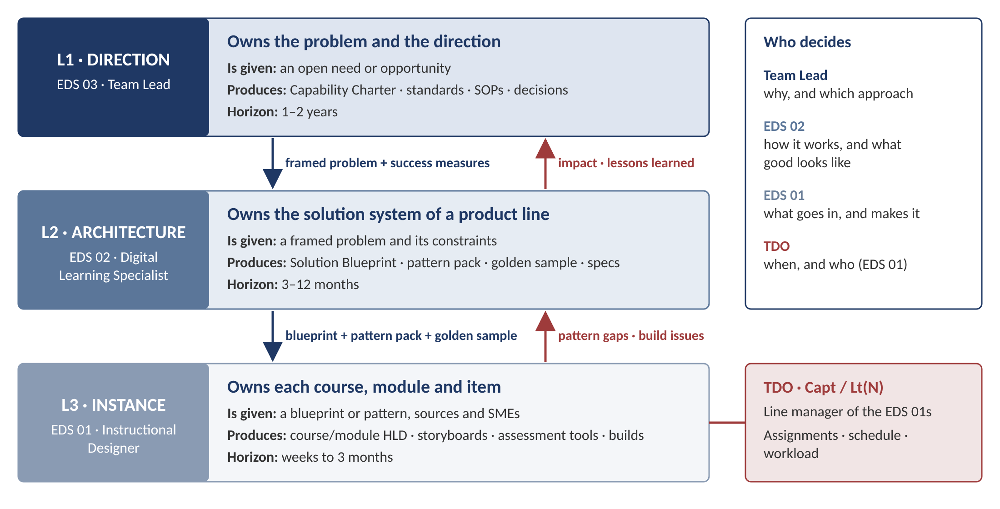
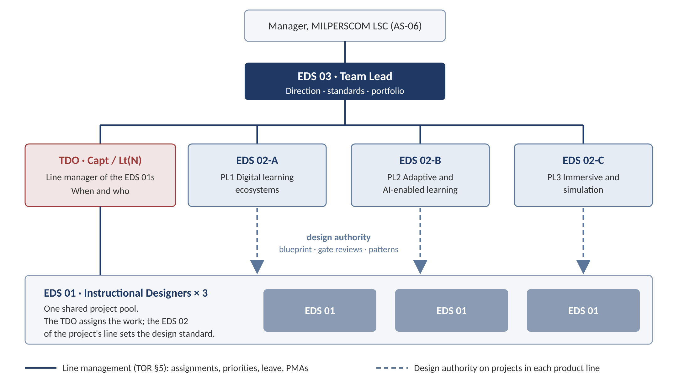

# Learning Engineering Cell: Role Architecture and Operating Model

*How the Team Lead (EDS 03), the Digital Learning Specialists (EDS 02) and the Instructional Designers (EDS 01) divide the work by level of design, by product line and by deliverable.*

MILPERSCOM Learning Support Centre, CFB Borden · Learning Engineering Cell · Draft v1.0 for team discussion · 22 October 2026

## 1. The model on one page

The three roles differ in **the level of the problem each one owns**. They do not differ in how hard the work is. Read across the table: each role receives the output of the role above it and turns it into something the role below it can act on.

| | EDS 03 · Team Lead | EDS 02 · Digital Learning Specialist | EDS 01 · Instructional Designer |
|---|---|---|---|
| **Owns** | The **problem** and the **direction** | The **solution system** for a product line | Each **instance** of that solution |
| **Core question** | Why this, which approach, and what counts as success? | How does this kind of product work, end to end, and does it reach the outcome? | What goes into this course, module, script or item, and is it right? |
| **Scope in the TOR** | Cell plan, standards, SOPs, research, clients (EDS 03 §2–3) | "Integrated digital learning ecosystems containing multiple connected components" (EDS 02 §2.a.i) | "This focus of work is at the course/product level" (EDS 01 §1) |
| **Receives** | An open need or opportunity | A framed problem with success measures | A blueprint, a pattern pack, sources and SMEs |
| **Produces** | Decisions, Capability Charters, standards, plans | Solution Blueprints, pattern packs, prototypes, specifications | Course/module HLDs, storyboards, assessment tools, builds |
| **Typical horizon** | 1–2 years | 3–12 months | Weeks to 3 months |
| **Judged by** | Portfolio outcomes and capabilities adopted | Reuse, coherence, less rework, shorter cycle time | Quality at first review, on-time delivery |

> **Rule of thumb.** The Team Lead decides what kind of thing the cell makes and why. The EDS 02 designs how that kind of thing works and builds the first one. The EDS 01s build the next ten, faster and to the same standard. The Training and Development Officer (TDO) decides when, and who among the EDS 01s.

This one rule settles the three questions that keep coming up:

1. **"What is the difference between EDS 02 and EDS 01?"** The EDS 02 designs the system and answers for whether the parts add up to the performance outcome. The EDS 01 designs and builds the parts inside that system and answers for each part being right.
2. **"EDS 02 takes the complex projects, EDS 01 the simple ones?"** Complexity decides *how much* of a project the EDS 02 is involved in (Section 7). It never decides *what kind* of work the EDS 02 does.
3. **"Should the cell be organized by product or by level?"** Both. Each EDS 02 is the design authority for one product line (the vertical axis). The levels of design run across every product line (the horizontal axis). Section 6 shows the grid.

## 2. Why the EDS 02 / EDS 01 line has blurred

The EDS 02s are doing much of the EDS 01 work and are asking what makes their role different. The TORs explain why. There are four causes, and none of them is about the people.

**a. The roles are told apart by difficulty alone.** If the EDS 02 does complex projects and the EDS 01 does simple ones, both do the same sequence of work: HLD, then storyboard, then build. Only the difficulty changes. Difficulty belongs to the project, not to the role, so the line moves every time a simple project turns complex or the cell runs short of capacity.

**b. The HLD is written into the EDS 01 TOR.** EDS 01 §4.a lists "High Level Design Documents" as an EDS 01 deliverable. If the EDS 02 is told to own the HLD, the TORs contradict the instruction. If the EDS 02 writes HLDs, they are doing work the TOR assigns to the EDS 01. The fix is to add the level above, a **Solution Blueprint** owned by the EDS 02, and to define the HLD as a course- or module-level document written inside the blueprint (Section 9).

**c. The EDS 02 has no line authority over the EDS 01.** The EDS 02 "Supervises: Nil" (EDS 02 §5.b), and the EDS 01 reports to the TDO (EDS 01 §5.a). "EDS 02 leads EDS 01" can therefore work only as **design authority**: setting and reviewing the design standard on a project. It cannot work as supervision (Section 4).

**d. Half of the EDS 02 TOR is not being done.** Much of the EDS 02 TOR is system-level or first-of-its-kind work: ecosystems and learner pathways (§2.a), documented AI workflows for repeatable production (§2.b.iv), immersive scenario logic and vendor requirements (§2.c), usability testing (§2.c.iv), a lessons-learned process (§3.f.i), cost estimates (§3.e.iii) and impact statements (§4.c). No other role in the cell covers this work. While the EDS 02s spend their weeks on module storyboards, it does not get done.

So the fix is not to rewrite the TORs. It is to make the existing TORs work by setting out four things: the levels of design, who decides what, the deliverable at each level, and a tier rule for how much EDS 02 time each project gets. Section 14 lists the small TOR edits that would remove the remaining contradictions.

## 3. The principle: three levels of work

Three well-established frameworks point to the same split.

- **Learning engineering process** (IEEE ICICLE). Learning engineering is an iterative, data-informed cycle: a *challenge* is framed, a solution is *created*, it is *implemented* with data collection, and the results are *investigated* to inform the next iteration. In this cell, the Team Lead frames the challenge and owns the investigation at the portfolio level. The EDS 02 runs the full cycle for a product line. The EDS 01 runs creation and implementation for each instance.
- **Levels of work** (Jaques, *Requisite Organization*). Roles differ by the time span and the ambiguity of the problems they are trusted to carry on their own: up to 3 months, 3 to 12 months, and 1 to 2 years are the first three bands. The theory is debated, and this model uses it only as a lens. It explains why "more complex storyboards" does not feel like a different job, while "own a product line for a year" does.
- **Design layers** (Gibbons, *An Architectural Approach to Instructional Design*). Every instructional design is a stack of layers: content, strategy, control, message, representation, media-logic and data management. For a given product type, the structural layers (strategy, control, media-logic, data management) can be decided once and reused. The content-facing layers (content, message, representation) must be designed fresh for every course. The first set is EDS 02 work. The second set is EDS 01 work.

| Level | Who | Is given | Produces | What is still unknown | Design layers mostly decided here |
|---|---|---|---|---|---|
| **L1 Direction** | Team Lead | An open need: "Could adaptive training cut seat time?" | A framed problem, a decision, success measures, a standard | The problem itself | None directly; sets goals and constraints |
| **L2 Architecture** | EDS 02 | A framed problem and its constraints | A Solution Blueprint, a pattern pack, a prototype, specifications | The solution | Strategy (structure), control, media-logic, data management |
| **L3 Instance** | EDS 01 | A blueprint or pattern, plus sources and SMEs | Course/module HLDs, storyboards, items, guides, builds | The right content for this course | Content, message, representation |

Two consequences follow:

- **When the architecture already exists, the EDS 01 can own every layer.** For maintaining an existing course, or for a new course built on a stable template, the architecture is already fixed in the standard. The EDS 01 works on all layers within it, and the EDS 02 is not needed (Tier 0).
- **When the EDS 02 produces an instance, it should be the first one.** The EDS 02 builds a full "golden sample" module to prove the blueprint and set the reference for everyone else. That is architecture work, even though the output looks like an EDS 01 product.

## 4. Structure: line management and design authority

The TORs set out the line structure: the Team Lead reports to the Manager, MILPERSCOM LSC (AS-06). The Team Lead supervises the TDO (Capt/Lt(N)), who supervises three EDS 01s, and the Team Lead also supervises three EDS 02s directly (EDS 03 §5). This model adds a second kind of authority on top of that line structure without changing it.

| | Line authority | Design authority |
|---|---|---|
| **Runs** | Team Lead → TDO → EDS 01; Team Lead → EDS 02 | EDS 02 → EDS 01, on projects in the EDS 02's product line |
| **Covers** | Assignments, priorities, schedule, workload, leave, conduct, PMAs | The blueprint the EDS 01 works to, design reviews at gates, patterns and templates, design questions |
| **Question it answers** | When, who and how much? | What does good look like here, and how does this product work? |

**What the EDS 02's design authority includes and excludes**

| The EDS 02 does | The EDS 02 does not |
|---|---|
| Set the Solution Blueprint for Tier 1–3 projects in their product line | Assign tasks or set deadlines for EDS 01s (TDO) |
| Approve or return an HLD or storyboard at the design gates (G2, G3) | Approve leave or write and assess PMAs (TDO / Team Lead) |
| Write and maintain the patterns, templates and how-to guides of their product line | Overrule an SME or Training Establishment on content accuracy |
| Give design feedback to the EDS 01 directly | Commit the cell to a client on scope or dates (Team Lead) |
| Raise quality or capacity issues with the TDO and the Team Lead | Take over an EDS 01's product, except as agreed surge (Section 13) |

The EDS 02's written design reviews can inform the TDO's view of an EDS 01's work, but the assessment belongs to the line.

A short way to remember the four roles: the **Team Lead** decides *why and which*, the **TDO** decides *when and who*, the **EDS 02** decides *how it works and what good looks like*, and the **EDS 01** decides *what goes in and makes it*. One practical benefit: the TDO is a military officer who rotates on posting. Placing design authority with the civilian EDS 02s keeps the cell's design standards stable across rotations.

## 5. Product lines: the vertical axis

The cell's products fall into two families. The **e-learning family** includes interactive (traditional) e-learning, instructional video, and adaptive e-learning, which is e-learning whose path or assessment changes with learner performance. Microlearning, job aids and instructor/learner guides are components inside an e-learning ecosystem. The **immersive family** includes VR/AR and simulation scenarios.

The EDS 02 TOR already falls into three themes, matching its Work Objectives 3.a, 3.b and 3.d. The cell also has three EDS 02s. This model gives each EDS 02 one primary product line and one backup line:

| Product line | Covers | Primary | Backup | TOR anchor |
|---|---|---|---|---|
| **PL1 Digital learning ecosystems** | Interactive e-learning, video, microlearning, job aids, guides, blended pathways | EDS 02-A | EDS 02-B | EDS 02 §2.a, WO 3.a |
| **PL2 Adaptive and AI-enabled learning** | Adaptive placement and assessment, item banks, learning analytics (xAPI), AI-enabled production workflows (Storyboard Master Prompt) | EDS 02-B | EDS 02-C | EDS 02 §2.b, WO 3.b–3.c |
| **PL3 Immersive and simulation** | VR/AR, simulation, branching scenarios, vendor requirements, usability testing | EDS 02-C | EDS 02-A | EDS 02 §2.c, WO 3.d |

- **All three EDS 02s still do the whole TOR.** The backup line gives continuity through leave and surges, and every EDS 02 does the cross-cutting work: lessons learned (WO 3.f), accessibility, usability and functional QA of their components (§2.d.i), and job aids and how-to guides (§2.e.ii, §4.d).
- **The EDS 01s are one shared pool.** The TDO assigns them to projects across all lines. An EDS 01 may come to specialize in one line over time, but the pool stays shared, and that is what lets the cell take on volume.
- **A project that spans lines has one Design Lead.** An example is an e-learning pre-brief, followed by VR practice and an adaptive post-test. The Design Lead is the EDS 02 of the line that carries the main performance outcome; the other EDS 02s are consulted.
- **Ownership of a line follows its maturity.** Once adaptive design is routine e-learning practice, PL2 can fold into PL1, and its EDS 02 moves to the next frontier (for example, AI tutoring or AR job aids). This keeps the EDS 02s at the leading edge, which is what the TOR asks of them ("Contributes to or leads modernization initiatives", WO 3.e.i).

<!-- pagebreak -->

## 6. The matrix: levels of design × products

This is the main working tool. Read down a column to follow one product from idea to build. Read across a row to see what one level of design does in every product.

| Level | Interactive e-learning | Video | Adaptive e-learning | VR / simulation |
|---|---|---|---|---|
| **L1 Direction · Team Lead** | Courseware standard and ID SOP; adopting the Storyboard Master Prompt; rule for when e-learning is the right answer | Rule for when video beats interaction; video, caption and bilingual standard | Why adaptive and for which courses; success measures; assessment-policy fit; pilot and research design | VR adoption criteria; device, safety and vendor policy; pilot and evaluation design |
| **L2 Architecture · EDS 02** | Ecosystem blueprint: course map, learner pathway, component mix, objective–assessment map, interaction pattern set, template bank | Series architecture: the job of each video in the pathway, length rules, script and shot-list templates, style guide | Adaptive model: placement design, mastery metric, routing rules, misconception-tag registry format, item specification, reporting, build pattern and fallback; prototype | Scenario architecture: performance criteria, scenario logic and branching map, state and feedback model, comfort and cognitive-load limits, vendor requirements, usability protocol, pre-brief → VR → debrief integration |
| **L3 Instance · EDS 01** | Module HLD, storyboards, lesson plans, assessment items to the Assessment Plan, instructor/learner guides | Scripts, storyboards and shot lists, on-screen text, narration | Scenario blocks and ladder items to the item spec, distractors and tags, refutation cards, route storyboards | Scenario scripts and voice lines, VR storyboard rows (VR Storyboard Master Prompt), pre-brief module, job aid |
| **L4 Build, QA, maintain · EDS 01 with developers, vendors, QA Officer** | DominKnow build or developer handoff; QA fixes; updates after policy change | Production coordination; captions and transcripts; version control | Variable and route build; route-by-route testing; item-bank upkeep | Vendor review cycles; asset and script checks; support to usability sessions |

How the EDS 02 relates to this grid:

- The EDS 02 **owns their column at L2**.
- The EDS 02 **reviews L3 at the design gates**.
- The EDS 02 **stays out of L3 work**, except for the golden sample.

The Team Lead **owns the whole of L1** and approves the L2 blueprints for complex and new-capability work (Tiers 2–3).

## 7. Engagement tiers: where complexity fits

Complexity enters the model as a tier, set at intake. The tier decides how much EDS 02 time a project gets. It never decides what kind of work the EDS 02 does.

| Tier | Typical request | EDS 02 role | EDS 01 role | Blueprint approved by |
|---|---|---|---|---|
| **T0 Maintain** | Update an existing course for a policy change or SME feedback; fix defects | None. Consulted only if a pattern has to change | Owns the work end to end (EDS 01 §2.g, WO 3.c) | Not applicable |
| **T1 Standard build** | A new course or module in an established product type that an existing pattern fits | Light: issues the standard blueprint from the line template (about one day); reviews at G3 | Owns the HLD, storyboards, assessment tools and build | EDS 02 |
| **T2 Complex build** | A multi-component ecosystem, several product types, scenario or branching logic, high-stakes assessment, or an external vendor | Design Lead: full blueprint, builds the golden sample, reviews at G2 and G3, tests integration | Builds the remaining modules to the blueprint and the golden sample | Team Lead |
| **T3 New capability** | A product type the cell has never delivered (for example, the first adaptive course or the first VR scenario) | Builds the pattern, the prototype and the pilot; writes the how-to guide | Supports pilot production; first users of the pattern; feeds back on it | Team Lead (Capability Charter and adoption decision) |

**Tier triggers.** The Team Lead confirms the tier at intake ("Receives, clarifies, and scopes requests", EDS 03 WO 3.e.i). Count which of these apply:

1. The learner pathway has more than one product type or component.
2. The learner's path depends on performance (branching, adaptive or scenario logic).
3. The assessment is high-stakes (qualification, certification, safety).
4. The project uses a new platform feature or an external developer or vendor.
5. Several Training Establishments or SME groups are involved, or the sources conflict.
6. No existing pattern or template fits.

If no trigger applies, the project is T0 for an update or T1 for a new build. Two or more triggers make it T2. Trigger 6 on its own makes it T3. The Team Lead can override the count, and records why.

> **Why the golden sample is EDS 02 work.** On a T2 project, the EDS 02 designs and builds the first module completely: HLD, storyboard, assessment and build. Its purpose is to test the blueprint and to set the standard the EDS 01s will match. A golden sample is a reference, not production. The second module is EDS 01 work.

## 8. Workflow, gates and decision rights

The stages below follow the cell's Learning Design Workflow in generic terms, so the stage names may need to be adjusted to the cell's own version. The workflow document uploaded earlier was not available while this draft was written. In the RACI below, R = does the work, A = approves the stage output (one per stage), C = consulted, and I = informed.

| Stage | Team Lead | TDO | EDS 02 | EDS 01 | QA Officer | SME / TE / client |
|---|---|---|---|---|---|---|
| **0 Intake and scoping**: request, feasibility, tier | **A/R** | C (capacity) | C (feasibility, cost estimate) | — | — | C |
| **1 Analysis**: performance, audience, sources, objectives from the Training Plan | A | I | R (T2–T3) | R (T0–T1) | — | C |
| **2 Solution architecture**: Solution Blueprint | A (T2–T3) | C (schedule) | **R** (and A for T1) | C | C | C |
| **3 Detailed design**: HLD, storyboards, assessment tools | I | C | **A** (design gates G2/G3) | **R** | C | C (validates content) |
| **4 Development**: build, media, vendor work | I | **A** (delivery) | C (R for vendor requirements) | **R** | C | I |
| **5 QA and validation**: standards, accessibility, bilingual, accuracy | **A** | I | R (ecosystem flow and usability) | R (fixes) | **R** | C |
| **6 Pilot and implementation** | **A** | C | R (T2–T3) | R (T0–T1) | I | C |
| **7 Evaluation and lessons learned** | **A** | C | **R** (owns the lessons-learned process) | C | C | C |
| **8 Standardize**: SOPs, templates, patterns | **A** | C | **R** (drafts the pattern and how-to guide) | C | C | — |

For T0 work the TDO approves Stage 3 (A) instead of the EDS 02, and the EDS 02 is not involved.

**Gates**

- **G0 · Scope and tier agreed** (Team Lead). The request is accepted, the tier is set, and the Design Lead is named.
- **G1 · Blueprint approved** (EDS 02 for T1; Team Lead for T2–T3). The TDO schedules the EDS 01 work from the module breakdown in the blueprint.
- **G2 · HLD conforms to the blueprint** (EDS 02; T2–T3 only). Checked before storyboarding starts, which is where rework is cheapest.
- **G3 · Storyboard approved** (SME validation and EDS 02 design review). The storyboard is "Developer Ready". For T1, this is the only EDS 02 review.
- **G4 · Build passes QA** (QA Officer, under the Team Lead's QA liaison, EDS 03 §2.c.i).
- **G5 · Pilot and impact review** (Team Lead). The EDS 02 presents the impact statement and the lessons learned.

**Who decides what**

| Role | Decides |
|---|---|
| **Team Lead** | Whether the cell accepts, declines or rescopes a request; the tier; the product type when it is contested; priorities and resource allocation; standards and SOPs; adopting a new method; client commitments; PMAs |
| **TDO** | Which EDS 01 does which work; sequencing and workload; the detailed production schedule |
| **EDS 02** | The solution architecture, component mix and learner pathway; the assessment strategy within the Assessment Plan; the patterns and templates of their line; design conformance at gates; technical requirements for developers and vendors. Recommends modality, tools and costs to the Team Lead |
| **EDS 01** | The instructional strategy inside a module; activity and item design; how content is transformed for learning; media recommendations. All within the blueprint and the standards |
| **SME / Training Establishment** | Content accuracy; the training requirement (Qualification Standard, Training Plan) |
| **QA Officer** | Compliance with LSC quality standards |

## 9. Deliverables cascade

Each level hands a defined deliverable to the level below and receives evidence back. Deliverables marked "new" are not named in the TORs but are what the TORs' wording already describes. EDS 02 §2.a.ii, for example, describes "learning flow diagrams, course maps and design rationale and alignment to learning outcomes", which together are a blueprint.

| Role | Deliverable | Contents | Goes to | TOR basis |
|---|---|---|---|---|
| **Team Lead** | Annual Learning Engineering Plan; work plans | Priorities, capacity, the capability roadmap | Manager LSC; whole cell | EDS 03 §2.a.i, §4.b |
| | **Capability Charter** (new) | Challenge, hypothesis, success measures, constraints, pilot scope, Design Lead, gate dates | EDS 02 Design Lead | EDS 03 WO 3.f.ii |
| | SOPs, standards, templates | The cell's way of working, updated from evidence | Whole cell | EDS 03 §4.a, WO 3.c.i, 3.f.iii |
| | Briefing notes and SITREPs; lessons learned; PMAs | Status, risks, capacity; cell-level lessons; performance agreements | Manager LSC; staff | EDS 03 §4.c–e |
| **EDS 02** | **Solution Blueprint** (new name for an existing duty) | Learner pathway, components, objective–assessment architecture, modality rationale, control and data logic, build approach, module breakdown, risks (Appendix A) | EDS 01s and TDO | EDS 02 §2.a.ii–iii |
| | **Pattern pack** (new) | Templates, pattern specifications, golden sample, how-to guide | EDS 01s | EDS 02 §2.b.iv, §4.d |
| | Scenario, adaptive and technical specifications; vendor requirements | Scenario logic, branching, performance criteria, build requirements | Developers and vendors | EDS 02 §2.c.ii–iii |
| | Prototype and usability findings; ecosystem validation | Tested prototype; flow without gaps or friction | Team Lead; EDS 01s | EDS 02 §2.c.iv, §2.d.ii |
| | Impact statements; lessons-learned documents; briefing notes on technology-enabled solutions; project and research notes | Evidence of effect; lessons learned; options and costs | Team Lead | EDS 02 §4.a–e |
| **EDS 01** | **Course/module HLD** | Objectives and teaching points, outline mapped to sources, strategy per objective, activities from the pattern set, assessment plan for the module, media list, duration, SME validation points | EDS 02 (G2); SME | EDS 01 §4.a |
| | Storyboards; lesson plans; scripts; instructor and learner guides | Developer-ready design of each screen, scene or lesson | Developers; SME; QA | EDS 01 §2.d, §4.b |
| | Assessment tools | Items and instruments built from the Assessment Plan | QA; SME | EDS 01 §2.j, §4.c |
| | Builds and updates; project notes | Authored product under version control; decision log | QA; TDO | EDS 01 §2.f, §4.d |

**Naming rule.** The Solution Blueprint is the product- or ecosystem-level design and belongs to the EDS 02. The HLD is the course- or module-level design and belongs to the EDS 01. On a T1 project, the blueprint is a one-page sheet filled in from the line template. On T0, there is no blueprint, because the existing standard plays that role.

## 10. Two lifecycles: projects and new capabilities

The cell runs two different lifecycles. Mixing them up is the main reason the Team Lead's role and the EDS 02's role blur.

- **The project lifecycle** makes a specific product (Sections 7–9). The EDS 02 architects it, the EDS 01 builds it, the TDO schedules it, and the Team Lead governs it.
- **The capability lifecycle** makes a new kind of product possible: the first adaptive course, the first VR scenario, the first AI-enabled workflow. The Team Lead leads, the EDS 02 builds, and the EDS 01 pilots. This is the "breakthrough" work of the Team Lead role.

| Stage | Team Lead | EDS 02 | EDS 01 | Exit decision (Team Lead) |
|---|---|---|---|---|
| **1 Scan** | Monitors learning science and technology trends (EDS 03 WO 3.d.i, 3.f.i) | Contributes research notes (EDS 02 §4.e) | — | Is the opportunity worth framing? |
| **2 Frame** | Writes the Capability Charter: challenge, hypothesis, measures, constraints | Assesses feasibility and estimates cost (EDS 02 WO 3.e.iii) | — | Prototype it? |
| **3 Prototype** | Reviews | Designs the model, builds the prototype, tests usability | Can act as test users | Does the prototype work? |
| **4 Pilot** | Approves the pilot and its research method (EDS 03 WO 3.f.ii) | Runs the pilot on one real course; builds the golden sample | Builds the pilot instances with the EDS 02 | Does the evidence meet the success measures? |
| **5 Standardize** | Writes the result into SOPs and templates (EDS 03 WO 3.f.iii) | Writes the pattern pack, the how-to guide and the lessons learned | Feeds back on how usable the pattern is | Adopt it as a standard product? |
| **6 Scale** | Sets portfolio targets in the annual plan | Reviews at gates only; moves to the next frontier | Builds at volume (T1) | — |

> **The Team Lead's part in a breakthrough.** The Team Lead does not design the adaptive course. The Team Lead asks the right question, chooses the method, sets the bar of evidence and decides adoption. The Capability Charter is the one-page tool for doing this: the challenge, a testable hypothesis, the success measures, the constraints, the method chosen and the alternatives rejected, the Design Lead, and the gate dates.

## 11. Worked example: adaptive assessment training

The cell will soon build an adaptive assessment product. It belongs to the e-learning family and to PL2. As a first-of-its-kind product it is T3, the next two courses will be T2, and once the pattern is stable each new course is T1.

**Step 1 · Team Lead: Capability Charter**

- **Challenge.** Members with prior experience sit through full courses. The cell has no standard way to credit what they already know.
- **Hypothesis.** A scenario-based placement at the start of the course lets experienced members skip content they have mastered without lowering their post-test mastery.
- **Success measures.** These are illustrative; the Team Lead sets the targets.
  - Seat time saved by experienced learners.
  - Post-test mastery no lower than on the full path.
  - Agreement between placement and post-test results.
  - Acceptance by learners and instructors.
  - Effort needed to build each additional course.
- **Constraints.**
  - DominKnow variables and conditional navigation.
  - SCORM reporting to the LMS.
  - Assessment policy, including who approves placement credit with the Training Authority.
  - Privacy of learner data used for analytics.
  - Bilingual parity.
- **Pilot.** MOD 13 DMCPG-5, already designed as the Bloom-Ladder Placement storyboard v6 with a working prototype.

**Step 2 · EDS 02 (PL2): turn the pilot into a pattern.** The MOD 13 v6 storyboard mixes two kinds of design. Separating them is the EDS 02's core contribution. The left column becomes the pattern every adaptive course reuses; the right column is what an EDS 01 writes for each new course.

| Element | Pattern: designed once by the EDS 02 | Instance: written for each course by the EDS 01 |
|---|---|---|
| Mastery metric | Levels L0–L3 on Bloom's taxonomy; the consecutive-pass (Guttman) rule; the anomaly rule (a failed lower rung caps the level) | — |
| Placement structure | One placement at the start of the course; one scenario block per sub-objective, three questions climbing the ladder; no feedback during placement; about 20 minutes at most | The scenarios and items for this course |
| Item specification | Each question answerable on its own; one attempt; randomization rules; every distractor that sets a level carries a misconception tag | The stems, options and distractor feedback |
| Misconception registry | The registry format: tag · misconception · where it fires · refutation card | The tags themselves (e.g. `all-wait-on-BTL`) and their refutation cards |
| Routing | The SKIP / POLISH / PRACTICE / FULL map; a refutation card is triggered by the distractor chosen | The entry slide for each section |
| Build | A scored question-page module, variables `v_SOn_L`, conditional navigation, and the native-gate fallback (Tier A) | The variables and pages for this course |
| Reporting | The SCORM score rule and the xAPI statements for analytics | — |
| QA | A route-by-route test script | The completed test log |

In Gibbons's terms, the pattern fixes the control and data-management layers, and the instance fills the content, message and representation layers.

**Step 3 · EDS 01: build at volume.** For course 2 onward, the TDO assigns EDS 01s. They work from the pattern pack and the Storyboard Master Prompt, and the EDS 02 reviews at G2 and G3 only. If an EDS 01 finds a case the pattern does not handle, it goes back to the EDS 02 as a change to the pattern, not as a one-off fix.

**Step 4 · Evidence and adoption.** The EDS 02 writes the impact statement and the lessons learned. The Team Lead decides whether to adopt adaptive placement as a standard product, updates the ID SOP, and names the courses that go adaptive next in the annual plan.

## 12. Worked example: "build the VR framework"

**Team Lead (L1).** VR adoption criteria: VR is justified when the task is spatial or procedural, when real practice is dangerous, costly or rare, and when success depends on cues that cannot be shown in 2D. The Capability Charter names:

- The pilot course.
- The success measures: performance criteria met in VR, transfer to the real task, and comfort issues reported.
- The device and vendor constraints.

**EDS 02, PL3 (L2).** The VR design framework:

- A performance-criteria template.
- A template for scenario logic and the branching map.
- The step state model: enter, prompt, success, error, idle and hint ladder.
- The feedback policy (in-world feedback first).
- Comfort and cognitive-load limits.
- A vendor requirements template.
- A usability-test protocol.
- How VR fits the ecosystem: pre-brief e-learning → VR practice → debrief and assessment → job aid.

The VR Storyboard Generator Master Prompt v1.0 already writes many of these rules down. It is the tool the EDS 01s use to produce instances.

**EDS 01 (L3–L4).** For each scenario, the EDS 01 writes:

- The scenario script and voice lines.
- The storyboard rows, using the master prompt.
- The pre-brief e-learning module and the job aid.

The EDS 01 also manages the vendor review cycles against the EDS 02's requirements.

## 13. Making it stick: time mix, measures and growth paths

**What the Team Lead can say to the EDS 02s.** "Your role is not a senior version of the EDS 01 role. It works at a different level. The EDS 01s answer for each course being right. You answer for the whole product line working: whether the pieces add up to the performance outcome, whether the next course can be built faster than the last one, and whether this year we can do things we could not do last year. That is what your TOR describes: ecosystems, AI workflows, immersive design, usability, lessons learned and impact statements. When you write a storyboard, it should be the first of its kind, the golden sample that sets the standard, or a surge we have both agreed to and can see on the plan."

**Starting time mix.** These targets should be calibrated after one quarter.

| EDS 02 | Share | EDS 01 | Share |
|---|---|---|---|
| Architecture and patterns: blueprints, specifications, pattern packs, prototypes | ~40% | Design and build of instances | ~70% |
| Design authority: gate reviews, design questions, coaching | ~20% | Maintenance and updates of existing products | ~20% |
| Evaluation, lessons learned, impact statements, usability, research notes | ~20% | QA, input to lessons learned, feedback on patterns | ~10% |
| Hands-on production: golden samples or agreed surge | ≤20% | | |

**Surge rule.** When capacity forces an EDS 02 to produce EDS 01-level work beyond golden samples, the TDO and the Team Lead agree it as surge, limit it in time, and show it in the SITREP. This keeps the trade-off visible: every week of surge is a week of architecture work not done.

**Measures, taken from the TORs' own indicators**

- **Team Lead.**
  - Delivery of the annual plan; capacity use.
  - Capability adoption decisions made on evidence.
  - Client feedback acted on (EDS 03 WO 3.b, 3.e.iv, 3.f).
- **EDS 02.**
  - Share of projects in the line built on the pattern pack.
  - Trend in rework and cycle time for EDS 01 builds in the line (WO 3.a.iv, 3.f.iii).
  - Ecosystem flow validated before pilot (§2.d.ii).
  - Three to six formal lessons-learned reports a year (WO 3.f.ii).
  - Development time saved through AI tools (WO 3.b.i).
  - Impact statements produced.
- **EDS 01.**
  - On-time delivery and first-pass rate at G3 and G4 (WO 3.a.iv).
  - Conformance to standards (WO 3.a.i–ii).
  - SME feedback integrated on time (WO 3.b.ii).
  - Updates that follow QA and version control (WO 3.c.iv).

**Growth paths**

- **EDS 01 toward EDS 02.** Write a T1 blueprint under EDS 02 review, contribute a pattern, and lead a lessons-learned session.
- **EDS 02 toward EDS 03.** Draft a Capability Charter, lead a stage of the capability lifecycle, and represent the cell with stakeholders.

## 14. Guardrails and TOR housekeeping

**Design authority is not supervision.** Write the design-authority duties into the EDS 02 PMAs, which the Team Lead writes (EDS 03 §4.e). Write "works to the approved blueprint and passes design review" into the EDS 01 PMAs. Design authority then becomes a standing expectation, not a personal request between colleagues. This model is built to avoid giving the EDS 02s supervisory duties. If the cell changes how work is assigned, confirm with HR or labour relations that it still does.

**Suggested edits at the next TOR revision**

1. **EDS 01 §4.a.** Change "High Level Design Documents" to "Course/module High Level Design Documents, within the approved Solution Blueprint".
2. **EDS 02 §4 Deliverables.** It lists no design deliverable at all, only briefing notes, lessons learned, impact statements, how-to guides and research notes. Add "Solution Blueprints and pattern packs", to match §2.a.ii and §2.b.iv.
3. **EDS 02 title.** The same position is called "Digital Learning Specialist" (job title), "Learning Specialist" (standardized job description) and "Learning Development Officer" (EDS 03 §5, and the "LDO" file header). Choose one.
4. **EDS 02 §3 numbering.** Item c ("Demonstrates measurable improvements … using AI derived analytics") is a performance indicator of objective b, not a separate objective.
5. **EDS 02 §2.d.** It is headed "Lessons Learned" but mostly lists QA and testing tasks. Retitle it "Quality, usability and lessons learned".
6. **Incomplete clauses.** EDS 02 §2.a.vii and EDS 01 §3.b.v are cut off in the source photographs. Recover the full text before the TORs are revised.
7. **EDS 03 §5.** State the working relationship: the TDO schedules the EDS 01s, and the EDS 02s provide design authority on projects in their product lines.

## 15. First 90 days

| When | Action | Owner |
|---|---|---|
| Weeks 1–2 | Brief the cell on this model in one session; confirm each EDS 02's primary and backup lines; agree the tier triggers and the surge rule; map the workflow stages in Section 8 onto the cell's Learning Design Workflow | Team Lead, with the TDO |
| Weeks 3–6 | Each EDS 02 drafts a blueprint template and pattern pack v0.1 for their line. PL1 starts from the Storyboard Master Prompt and the slide template bank, PL2 from MOD 13 Bloom-Ladder v6, and PL3 from the VR Storyboard Master Prompt v1.0. | EDS 02s |
| Weeks 3–6 | Write the Capability Charter for adaptive assessment training | Team Lead |
| Weeks 7–12 | Run one T2 project and the adaptive pilot through the new gates | EDS 02 Design Leads, EDS 01s, TDO |
| Week 12 | Hold a lessons-learned review of the model itself; adjust the time-mix targets and the tier triggers; update the ID SOP; carry the changes into the next PMA cycle | Team Lead |

## Appendix A. Blueprint and HLD contents checklists

**Solution Blueprint (EDS 02, product or ecosystem level)**

1. The performance outcome and success measures, from the Capability Charter or the Training Plan.
2. A learner pathway diagram: components, sequence, entry and exit points, prerequisites.
3. The objective–assessment architecture: the objectives from the Training Plan, mapped to components and to assessment points.
4. The modality rationale for each component: why e-learning, video, VR or adaptive.
5. The patterns and templates to use, with a reference to the golden sample.
6. The control and data logic: branching or adaptive rules, variables, reporting.
7. The build approach: platform features, vendor requirements, fallback.
8. Constraints: accessibility, bilingual, security, privacy, copyright.
9. The module breakdown, with the tier and estimated effort of each module. The TDO schedules from this list.
10. Risks, open questions and their owners.

**Course/module HLD (EDS 01, within the blueprint)**

1. The module objectives and teaching points, traced to the blueprint and the sources.
2. A content outline mapped to the source documents. Gaps are owned by a named person, never filled by invention.
3. The instructional strategy for each objective: for example, teach, show, practise, assess.
4. Activities and interactions, chosen from the pattern set.
5. A module assessment plan built from the Assessment Plan.
6. A media list with the purpose of each asset.
7. An estimated duration.
8. The points where the SME validates content, with dates.

## References

- Cooper, R. G. (1990). Stage-gate systems: A new tool for managing new products. *Business Horizons, 33*(3), 44–54.
- Gibbons, A. S. (2014). *An architectural approach to instructional design*. Routledge.
- Goodell, J., & Kolodner, J. (Eds.). (2023). *Learning engineering toolkit: Evidence-based practices from the learning sciences, instructional design, and beyond*. Routledge.
- IEEE ICICLE. (n.d.). *Learning engineering process*. https://sagroups.ieee.org/icicle/learning-engineering-process
- Jaques, E. (1996). *Requisite organization: A total system for effective managerial organization and managerial leadership for the 21st century* (2nd ed.). Cason Hall.
- MILPERSCOM LSC. Terms of Reference: Learning Engineering Team Lead (EDS 03); Digital Learning Specialist (EDS 02); Instructional Designer (EDS 01).
- LSC Learning Engineering Cell. Storyboard Generator Master Prompt; VR Storyboard Generator Master Prompt v1.0; MOD 13 DMCPG-5 Bloom-Ladder Placement Design v6.
